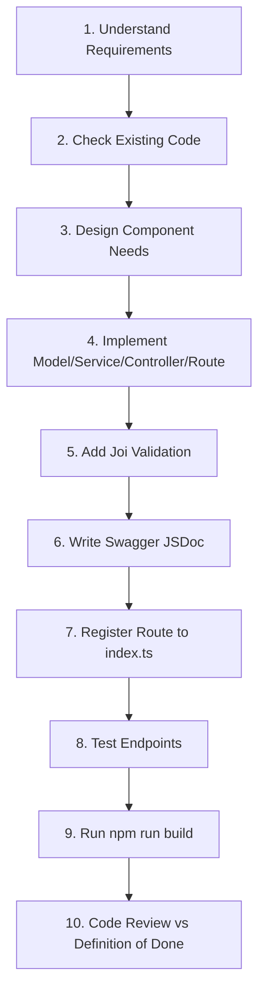

# SmartCook Backend — AI Agent Instructions

> **File Role:** Technical Architecture & Engineering Guidelines for AI Coding Agents.  
> **Question this file answers:** *AI CODING AGENT PHẢI LÀM VIỆC NHƯ THẾ NÀO TRONG REPOSITORY NÀY?*  
> **Scope:** Áp dụng bắt buộc cho tất cả các phiên làm việc của AI (Antigravity, Cursor, Copilot, Claude, GPT).

---

## 1. Purpose
Tài liệu này định nghĩa toàn bộ quy chuẩn kỹ thuật, kiến trúc phân lớp, nguyên tắc lập trình, quy trình kiểm soát chất lượng và quy tắc ứng xử bắt buộc khi AI làm việc trên repository **SmartCook Backend**.

---

## 2. Source of Truth
Khi tiếp nhận yêu cầu từ người dùng, AI phải tuân theo thứ bậc nguồn chân lý (Hierarchy of Truth) sau:

1. **Business Requirements (Nghiệp vụ chức năng & phạm vi):**  
   👉 Đọc tại [SMARTCOOK_REQUIREMENTS.md](./SMARTCOOK_REQUIREMENTS.md).
2. **Technical Architecture & Rules (Tiêu chuẩn kỹ thuật & quy tắc):**  
   👉 Đọc tại chính file `AGENTS.md` này kết hợp với source code thực tế.
3. **Actual Implementation (Mã nguồn hiện hành):**  
   👉 Source code trong thư mục `src/` phản ánh trạng thái chạy thực tế.
4. **Xử lý xung đột (Conflict Resolution):**  
   - Nếu tài liệu mâu thuẫn với source code: **Kiểm tra kỹ source code trước**, không tự ý ghi đè hoặc phá vỡ code đang chạy tốt.
   - Luôn tôn trọng code đã implement, trừ khi người dùng yêu cầu refactor rõ ràng.

---

## 3. Project Context
- **Dự án:** SmartCook Backend.
- **Mục đích:** Hệ sinh thái API cung cấp dịch vụ cho ứng dụng di động trợ lý nấu ăn thông minh SmartCook (React Native / Expo).
- **Trạng thái codebase hiện tại:**
  - Hệ thống khung cơ sở (Base), cấu hình môi trường, security, logging, error handling, rate limiting, Swagger UI và endpoint health check (`GET /api/v1/health`) đã được thiết lập hoàn chỉnh `[Implemented]`.
  - 25 modules nghiệp vụ đang ở trạng thái chuẩn bị phát triển `[Planned]` hoặc `[Future]`.

---

## 4. Tech Stack
- **Runtime:** Node.js v22+
- **Ngôn ngữ:** TypeScript (Strict Mode)
- **Web Framework:** Express.js v5
- **Database & ODM:** MongoDB v7+ qua Mongoose v9+
- **Security & Performance:** `helmet`, `cors`, `compression`, `express-rate-limit`
- **Validation:** `joi`
- **Logging:** `morgan`
- **API Documentation:** Swagger UI (`swagger-ui-express`, `swagger-jsdoc`)
- **Dev Runner & Build:** `tsx` (dev hot-reload), `tsc` (production build ra `dist/`)
- **Containerization:** Multi-stage Dockerfile, `docker-compose.yml`

---

## 5. Architecture
Hệ thống tuân thủ nghiêm ngặt **Kiến trúc 3 lớp phân tách trách nhiệm (3-Tier Layered Architecture)**:

```text
HTTP Request
     ↓
Route (src/routes/)               → Gắn URL, Middleware, Validator, Controller, Swagger JSDoc
     ↓
Controller (src/controllers/)     → Trích xuất req.body/params/query, gọi Service, trả response qua ok() / fail()
     ↓
Service (src/services/)           → Xử lý 100% Business Logic, tính toán, thao tác Mongoose Models, throw AppError
     ↓
Model (src/models/)               → Mongoose Schema, Type Interface, Indexing
     ↓
Database (MongoDB)
```

---

## 6. Folder Structure
```text
smartcook-backend/
├── .github/workflows/ci.yml # CI Pipeline tự động (test build & docker)
├── dist/                    # Compiled JavaScript output
├── src/
│   ├── config/              # db.ts, env.ts, swagger.ts
│   ├── controllers/         # Điều phối HTTP request/response (*.controller.ts)
│   ├── services/            # Toàn bộ business logic (*.service.ts)
│   ├── models/              # Mongoose schema & TypeScript types (*.model.ts)
│   ├── routes/              # Khai báo endpoint & Swagger (*.route.ts, index.ts)
│   ├── middlewares/         # errorHandler.ts, rateLimit.ts, validate.ts, auth.middleware.ts
│   ├── validators/          # Schemas Joi dùng chung (*.validator.ts)
│   ├── utils/               # AppError (errors.ts), ok/fail (response.ts)
│   ├── app.ts               # Khởi tạo Express app & gắn global middleware
│   └── server.ts            # Entrypoint kết nối DB, listen port & Graceful Shutdown
├── .dockerignore
├── .env / .env.example
├── .gitignore
├── .prettierrc
├── AGENTS.md                # File hướng dẫn dành cho AI (HOW AI WORKS)
├── Dockerfile / docker-compose.yml
├── package.json
├── SMARTCOOK_REQUIREMENTS.md# Tài liệu đặc tả 25 modules (WHAT SMARTCOOK DOES)
└── tsconfig.json
```

---

## 7. Layer Responsibilities

### 7.1. Routes (`src/routes/*.route.ts`)
- **Được làm:** Định nghĩa method và path; gắn middleware (auth, validate, rateLimit); gắn controller handler; viết block comment `/** @swagger ... */`.
- **KHÔNG được làm:** Không viết logic tính toán, không truy vấn database, không gọi service trực tiếp mà bỏ qua controller.

### 7.2. Controllers (`src/controllers/*.controller.ts`)
- **Được làm:** Trích xuất dữ liệu từ `req.body`, `req.query`, `req.params`; gọi Service; trả response bằng `ok(res, data, message)` hoặc `fail(res, message, status)`; bọc code trong khối `try/catch` và chuyển lỗi tới `next(error)`.
- **KHÔNG được làm:** Không truy vấn Mongoose Model; không chứa logic nghiệp vụ; không thực hiện tính toán phức tạp.

### 7.3. Services (`src/services/*.service.ts`)
- **Được làm:** Chứa 100% logic nghiệp vụ; truy vấn database qua Mongoose Models; tính toán thuật toán; gọi các provider bên ngoài (AI, Mail); ném lỗi nghiệp vụ bằng `throw new AppError(message, statusCode)`.
- **KHÔNG được làm:** Tuyệt đối không nhận hoặc phụ thuộc vào các đối tượng Express (`req`, `res`, `next`).

### 7.4. Models (`src/models/*.model.ts`)
- **Được làm:** Khai báo TypeScript Interface; định nghĩa Mongoose Schema; cấu hình `timestamps: true`; đánh index phù hợp (`unique`, `index`, compound index, text index).
- **Quy tắc quan trọng (Do NOT force model creation):**
  1. Luôn kiểm tra model hiện có trước khi tạo mới.
  2. Chỉ tạo model mới khi dữ liệu thực sự cần lưu trữ bền vững (persistence) độc lập trong database.
  3. Không tạo model thừa nếu dữ liệu có thể nhúng hợp lý (embedded subdocument) vào model sẵn có.

---

## 8. Coding Rules
- Viết code TypeScript nghiêm ngặt (Strict Mode), hạn chế tối đa sử dụng `any`. Khai báo kiểu dữ liệu rõ ràng cho hàm và biến.
- Luôn sử dụng async/await thay cho raw callback hay raw promise chaining phức tạp.
- Tuân thủ nguyên tắc Single Responsibility Principle (Mỗi file/hàm chỉ làm đúng 1 nhiệm vụ).
- Không duplicate code: Tái sử dụng helper trong `src/utils/` và middleware trong `src/middlewares/`.

---

## 9. Naming Conventions
- **Tên file:** Kebab-case kèm hậu tố định danh:
  - `user.model.ts`
  - `user.service.ts`
  - `user.controller.ts`
  - `user.route.ts`
  - `user.validator.ts`
- **Tên Class:** PascalCase (`UserService`, `RecipeController`, `HealthService`).
- **Tên Hàm / Biến:** camelCase (`calculateMatchingScore`, `getUserProfile`).
- **Tên Mongoose Collections:** Số nhiều, camelCase hoặc lowercase (`users`, `recipes`, `mealPlans`, `shoppingLists`).

---

## 10. Validation
- Sử dụng thư viện **`joi`** để validate toàn bộ dữ liệu đầu vào.
- Schema đặt tại `src/validators/<feature>.validator.ts` hoặc trực tiếp trong route nếu schema ngắn gọn.
- Sử dụng middleware [src/middlewares/validate.ts](file:///e:/FPTU/Term07/project/smartcook-backend/src/middlewares/validate.ts) theo cú pháp:
  ```ts
  router.post("/register", validate(registerSchema, "body"), AuthController.register);
  ```
- Không duplicate logic validation rải rác trong Controller hay Service.

---

## 11. API Response Format
Mọi response API bắt buộc phải đi qua các hàm helper tại [src/utils/response.ts](file:///e:/FPTU/Term07/project/smartcook-backend/src/utils/response.ts):

### 11.1. Thành công chuẩn
```json
{
  "success": true,
  "message": "Operation successful",
  "data": { ... }
}
```

### 11.2. Danh sách có phân trang
```json
{
  "success": true,
  "message": "Recipes retrieved successfully",
  "data": [ ... ],
  "pagination": {
    "page": 1,
    "limit": 10,
    "total": 100,
    "totalPages": 10
  }
}
```

### 11.3. Lỗi
```json
{
  "success": false,
  "message": "Chi tiết nguyên nhân lỗi"
}
```

---

## 12. Error Handling
- Khi có lỗi nghiệp vụ trong Service, luôn ném ra `AppError`:
  ```ts
  throw new AppError("Không tìm thấy công thức này", 404);
  ```
- Controller luôn bắt lỗi và chuyển giao cho middleware tập trung:
  ```ts
  try {
    const data = await FeatureService.doSomething();
    ok(res, data, "Success");
  } catch (error) {
    next(error);
  }
  ```
- [src/middlewares/errorHandler.ts](file:///e:/FPTU/Term07/project/smartcook-backend/src/middlewares/errorHandler.ts) tự động xử lý các lỗi đặc thù:
  - Mongoose `CastError` -> trả về 404 Resource not found.
  - Mongoose duplicate key `11000` -> trả về 400 Duplicate value.
  - Mongoose `ValidationError` -> trả về 400 kèm chi tiết lỗi.
  - JWT `JsonWebTokenError` / `TokenExpiredError` -> trả về 401.
- Không bao giờ trả stack trace ra ngoài cho client trên môi trường production.

---

## 13. Authentication
- **MVP:** Sử dụng Stateless JWT Bearer Token gửi qua header: `Authorization: Bearer <token>`.
  - Middleware `auth.middleware.ts` giải mã token, gắn thông tin `req.user = decoded` vào request context.
  - Đăng xuất ở giai đoạn MVP được xử lý phía Client bằng cách xóa token khỏi storage.
- **Future:** Mở rộng cơ chế Refresh Token lưu trong database và hỗ trợ thu hồi token từ phía server (`POST /api/v1/auth/refresh`).

---

## 14. Database Rules
- Luôn định nghĩa TypeScript Interface song hành cùng Mongoose Schema.
- Không truy vấn DB thừa: Sử dụng `.select()`, `.lean()` cho các query chỉ đọc (read-only) để tối ưu RAM và CPU.
- Đánh index thích hợp:
  - Trường duy nhất: `unique: true` (`email`, `slug`).
  - Trường tìm kiếm thường xuyên: `index: true` (`user`, `category`, `createdAt`).
  - Tìm kiếm toàn văn bản: Text index trên `title` và `tags` của Recipe.
- Dữ liệu nhật ký hành vi thô (`UserBehavior`) phải có TTL index để MongoDB tự động dọn dẹp sau 90 ngày.

---

## 15. Swagger / API Documentation
- Mỗi endpoint mới đều **bắt buộc** phải có chú thích JSDoc `@swagger` đầy đủ:
  - `tags`: Nhóm chức năng (Auth, Recipe, Inventory...).
  - `summary` & `description`: Mô tả rõ ràng bằng tiếng Việt.
  - `parameters` / `requestBody`: Định nghĩa schema tham số đầu vào.
  - `responses`: Định nghĩa mã `200`, `400`, `401`, `404` tương ứng.
- Swagger UI luôn truy cập tại: `http://localhost:5000/api-docs`.
- Không viết Swagger mâu thuẫn với implementation thực tế.

---

## 16. Security
- Tận dụng hệ thống bảo mật có sẵn trong [src/app.ts](file:///e:/FPTU/Term07/project/smartcook-backend/src/app.ts):
  - `helmet`: Tự động gỡ `X-Powered-By`, bật CSP, HSTS, NoSniff.
  - `cors`: Kiểm soát domain được phép truy cập qua `env.CORS_ORIGIN`.
  - `express-rate-limit`: Áp dụng `apiLimiter` cho toàn bộ router `/api` và `authLimiter` cho các endpoint nhạy cảm.
  - `compression`: Nén Gzip cho response payload.
- **Quy tắc bảo mật code:**
  - Không hard-code mật khẩu, token, connection string vào code.
  - Mọi cấu hình nhạy cảm đều đọc qua [src/config/env.ts](file:///e:/FPTU/Term07/project/smartcook-backend/src/config/env.ts).
  - Không bao giờ commit file `.env` lên Git.

---

## 17. AI Feature Rules
Khi triển khai các tính năng AI trong SmartCook (Scan nguyên liệu, Gợi ý món, Smart Search, Sinh công thức AI), phải tuân thủ 3 quy tắc thiết kế:

### 17.1. Abstraction Layer (Không phụ thuộc cứng nhà cung cấp)
Luôn bọc lời gọi AI qua tầng Provider Interface:
```text
Controller
    ↓
Service (AIRecipeGeneratorService)
    ↓
Provider Abstraction (LLMProvider Interface)
    ↓
OpenAIProvider / GeminiProvider / MockProvider
```
Cho phép thay đổi nhà cung cấp AI mà không phải sửa logic nghiệp vụ của Service.

### 17.2. Smart Search — Tuyệt đối không sinh trực tiếp MongoDB Query
```text
User Natural Language ("Món dưới 30 phút có gà")
    ↓
SmartSearchParser (Regex / NLP trích xuất Intent)
    ↓
SearchCriteria Object (JSON an toàn)
    ↓
RecipeService (Tự xây dựng Mongoose Query an toàn)
    ↓
MongoDB Execution
```
*Nghiêm cấm để LLM sinh trực tiếp cú pháp query MongoDB để tránh rủi ro NoSQL Injection.*

### 17.3. Structured Output
Kết quả sinh từ LLM (như Module 25 AI Recipe Generator) bắt buộc phải là JSON có cấu trúc khớp với `Recipe` Schema, và phải được validate bằng Joi trước khi lưu hoặc trả về cho client.

---

## 18. Testing
- Trước khi hoàn tất bất kỳ tính năng nào, luôn kiểm tra:
  - Happy Path (Dữ liệu chuẩn hoạt động đúng).
  - Validation Errors (Gửi thiếu trường bắt buộc phải nhận 400).
  - Authentication (Không có token phải nhận 401).
  - Not Found (Sai ID phải nhận 404).
- **Lệnh kiểm tra bắt buộc:**
  ```bash
  npm run build
  ```
  Code phải biên dịch 100% không có lỗi TypeScript trước khi kết thúc task.

---

## 19. Git Workflow
- **Cấu trúc nhánh:**
  - `main`: Nhánh Production, code luôn phải ổn định nhất.
  - `develop`: Nhánh Integration, nơi tích hợp toàn bộ tính năng.
  - `feature/<name>`: Nhánh làm tính năng con (ví dụ: `feature/auth`, `feature/recipe`).
- **Quy trình chuẩn:**
  1. Tách nhánh mới từ `develop`: `git checkout -b feature/<name>`.
  2. Code, commit chuẩn Conventional Commits: `feat: ...`, `fix: ...`, `docs: ...`.
  3. Push lên GitHub và tạo Pull Request vào nhánh `develop`.
  4. GitHub Actions CI sẽ tự động kiểm tra `npm run build` và Docker build.

---

## 20. Feature Implementation Workflow (10 Bước chuẩn khi code)

Mỗi khi người dùng yêu cầu AI lập trình một tính năng mới, AI phải thực hiện tuần tự 10 bước:



1. **Step 1 — Understand:** Đọc đặc tả nghiệp vụ của module trong [SMARTCOOK_REQUIREMENTS.md](./SMARTCOOK_REQUIREMENTS.md).
2. **Step 2 — Check Existing Code:** Rà soát `src/models/`, `src/services/`, tránh tạo trùng lặp.
3. **Step 3 — Design:** Xác định chính xác các thành phần cần tạo (Chỉ tạo những file thực sự cần).
4. **Step 4 — Implement:** Viết code theo thứ tự: `Model -> Service -> Controller -> Route`.
5. **Step 5 — Validate:** Viết schema kiểm tra dữ liệu đầu vào với `joi`.
6. **Step 6 — Swagger:** Viết comment block `/** @swagger ... */` cho từng endpoint.
7. **Step 7 — Register:** Nhúng route con mới vào [src/routes/index.ts](file:///e:/FPTU/Term07/project/smartcook-backend/src/routes/index.ts).
8. **Step 8 — Test:** Kiểm tra các kịch bản thành công và ngoại lệ.
9. **Step 9 — Build:** Chạy lệnh `npm run build` để kiểm tra TypeScript.
10. **Step 10 — Review:** Tự rà soát lại theo checklist Definition of Done bên dưới.

---

## 21. Definition of Done (DoD Checklist)
Một tính năng chỉ được coi là hoàn thành khi đáp ứng đủ 13 tiêu chí:
- [ ] Requirement nghiệp vụ trong `SMARTCOOK_REQUIREMENTS.md` đã được đối chiếu.
- [ ] Code hiện có đã được kiểm tra, không tạo trùng lặp Service/Model.
- [ ] Tuân thủ chuẩn kiến trúc 3 lớp (Không viết logic ở Route, không query DB ở Controller, không nhận req/res ở Service).
- [ ] Input Validation đã được xử lý bằng Joi.
- [ ] Xác thực (Authentication) và phân quyền (Authorization) được gắn đúng endpoint.
- [ ] Bắt lỗi tập trung với `AppError` và `errorHandler`.
- [ ] Response format trả về đúng chuẩn qua `ok()` hoặc `fail()`.
- [ ] Tài liệu Swagger JSDoc đầy đủ cho mọi endpoint mới.
- [ ] Route mới đã được đăng ký vào `src/routes/index.ts`.
- [ ] Các trường hợp lỗi biên (Edge Cases) đã được tính đến.
- [ ] Lệnh `npm run build` biên dịch thành công 0 lỗi.
- [ ] Tuyệt đối không hard-code bất kỳ secret hay password nào.
- [ ] Không làm ảnh hưởng hoặc làm hỏng mã nguồn của các module không liên quan.

---

## 22. Forbidden Practices (Những điều AI TUYỆT ĐỐI KHÔNG LÀM)
- ❌ **Không tự ý recreate project:** Không xóa code làm lại từ đầu hoặc thay đổi cấu trúc khi không có yêu cầu.
- ❌ **Không đổi framework/database:** Giữ nguyên Express 5, TypeScript và MongoDB (Mongoose 9).
- ❌ **Không query Database trong Controller:** Mọi truy vấn Mongoose bắt buộc phải nằm trong Service.
- ❌ **Không viết business logic trong Route.**
- ❌ **Không truyền `req` hoặc `res` vào Service.**
- ❌ **Không cho LLM sinh trực tiếp MongoDB Query thô:** Phải qua `SmartSearchParser` trích xuất criteria an toàn.
- ❌ **Không hard-code secrets hoặc commit file `.env`.**
- ❌ **Không áp dụng Repository Pattern tràn lan** gây cồng kềnh, phức tạp hóa kiến trúc không cần thiết. Ưu tiên kiến trúc 3 lớp đơn giản, tinh gọn và hiệu quả.

---

## 23. Requirements Reference
- Đặc tả chi tiết 25 modules và thiết kế database schema: 👉 **[SMARTCOOK_REQUIREMENTS.md](./SMARTCOOK_REQUIREMENTS.md)**
- Cấu hình Swagger API: [src/config/swagger.ts](file:///e:/FPTU/Term07/project/smartcook-backend/src/config/swagger.ts)
- Bộ middleware bảo mật & rate limiting: [src/middlewares/rateLimit.ts](file:///e:/FPTU/Term07/project/smartcook-backend/src/middlewares/rateLimit.ts)
- Bộ format phản hồi: [src/utils/response.ts](file:///e:/FPTU/Term07/project/smartcook-backend/src/utils/response.ts)
