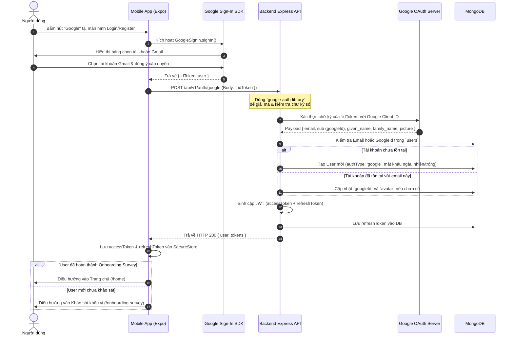

# Danh Sách Task & Kế Hoạch Triển Khai: Đăng Nhập Bằng Google (Google Sign-In)

> **Dự án:** SmartCook System (Backend Node.js + Mobile React Native / Expo)  
> **Giải pháp kiến trúc:** Google ID Token Verification (Chuẩn bảo mật OAuth 2.0 / OpenID Connect)

---

## 1. Sơ Đồ Luồng Xác Thực (Authentication Flow)



---

## 2. Danh Sách Task Chi Tiết

### GIAI ĐOẠN 1: Cấu Hình Trên Google Cloud Console (Dev Setup)
- [x] **Task 1.1: Tạo Google Cloud Project**
  - Đã tạo project `SmartCook-App`.
- [x] **Task 1.2: Cấu hình OAuth Consent Screen (Màn hình đồng ý OAuth)**
  - Đã chọn User Type External, cấu hình Audience và thêm Test Users.
- [x] **Task 1.3: Tạo Web Application Client ID (BẮT BUỘC cho Backend)**
  - Đã tạo Web OAuth Client ID: `315474311920-e4i728d68vus6qth8jhplccps2ecsv7o.apps.googleusercontent.com`.
- [ ] **Task 1.4: Tạo Android & iOS Client ID (Cho Mobile Standalone App)**
  - Android: Cung cấp Package name (từ `app.json`) và mã băm SHA-1 fingerprint từ máy phát triển.
  - iOS: Cung cấp Bundle Identifier (từ `app.json`).

---

### GIAI ĐOẠN 2: Triển Khai Phía Backend (`smartcook-backend`)

- [x] **Task 2.1: Cài đặt thư viện xác thực chính thức từ Google**
  - Đã cài đặt `google-auth-library`.
- [x] **Task 2.2: Cập nhật biến môi trường**
  - Đã thêm `GOOGLE_CLIENT_ID` vào `.env` và `.env.example`.
- [x] **Task 2.3: Nâng cấp `src/config/env.ts`**
  - Đã khai báo trường `GOOGLE_CLIENT_ID: string` vào interface `EnvConfig` và `getEnv()`.
- [x] **Task 2.4: Nâng cấp Schema `User` (`src/models/User.ts`)**
  - Đã thêm `googleId` (unique sparse), `authType` ('local' | 'google' | 'facebook'), và làm mật khẩu optional khi `authType === 'google'`.
- [x] **Task 2.5: Cập nhật `src/repositories/user.repository.ts`**
  - Đã viết method `findByGoogleId` và `linkGoogleId`.
- [x] **Task 2.6: Viết Joi Validator (`src/validators/auth.validator.ts`)**
  - Đã tạo `googleAuthSchema` kiểm tra tính hợp lệ của `idToken`.
- [x] **Task 2.7: Xây dựng Service Logic (`src/services/auth.service.ts`)**
  - Đã viết method `loginWithGoogle` xác thực chữ ký token với Google OAuth2Client, tự động liên kết tài khoản (Account Linking), tạo mới tài khoản và cấp JWT tokens.
- [x] **Task 2.8: Viết Controller (`src/controllers/auth.controller.ts`)**
  - Đã thêm action `googleLogin` xử lý request và trả về ApiResponse chuẩn.
- [x] **Task 2.9: Đăng ký Route (`src/routes/auth.route.ts`)**
  - Đã thêm route `POST /auth/google` với middleware Joi validation.
- [x] **Task 2.10: Viết Swagger Documentation (`src/docs/auth.swagger.ts`)**
  - Đã bổ sung tài liệu OpenAPI / Swagger cho endpoint `POST /auth/google`.

---

### GIAI ĐOẠN 3: Triển Khai Phía Mobile Client (`smartcook-mobile`)

- [ ] **Task 3.1: Cài đặt thư viện Google Sign-In**
  - Cài đặt thư viện chuẩn:
    ```bash
    npx expo install @react-native-google-signin/google-signin
    ```
    *(Hoặc sử dụng `expo-auth-session` nếu chạy môi trường Expo Go thuần)*.
- [ ] **Task 3.2: Cấu hình Client ID trong mã nguồn Mobile**
  - Khởi tạo cấu hình tại file khởi động hoặc trong `AuthContext`:
    ```typescript
    GoogleSignin.configure({
      webClientId: 'GOOGLE_WEB_CLIENT_ID_TU_TASK_1_3',
      offlineAccess: false,
    });
    ```
- [ ] **Task 3.3: Viết API Client Service (`src/services/authApi.ts`)**
  - Viết hàm gọi backend:
    ```typescript
    export async function loginWithGoogleApi(idToken: string) {
      return apiClient.post('/auth/google', { idToken });
    }
    ```
- [ ] **Task 3.4: Gắn sự kiện vào component `SocialAuthButtons.tsx`**
  - Tại [`src/components/auth/SocialAuthButtons.tsx`](file:///e:/FPTU/Term07/project/smartcook-mobile/src/components/auth/SocialAuthButtons.tsx): Nút Google gọi prop `onGooglePress`.
  - Tại [`src/app/login.tsx`](file:///e:/FPTU/Term07/project/smartcook-mobile/src/app/login.tsx) và [`src/app/register.tsx`](file:///e:/FPTU/Term07/project/smartcook-mobile/src/app/register.tsx):
    ```typescript
    const handleGoogleSignIn = async () => {
      try {
        await GoogleSignin.hasPlayServices();
        const response = await GoogleSignin.signIn();
        const idToken = response.data?.idToken;
        if (!idToken) throw new Error("Không lấy được ID Token từ Google");
        
        // Gửi lên backend
        const res = await loginWithGoogleApi(idToken);
        const { user, tokens } = res.data;
        
        // Lưu token vào SecureStore
        await saveTokens(tokens.accessToken, tokens.refreshToken);
        
        // Điều hướng
        if (user.preferences?.hasCompletedSurvey) {
          router.replace('/home');
        } else {
          router.replace('/onboarding-survey');
        }
      } catch (error) {
        Alert.alert("Lỗi đăng nhập", "Không thể đăng nhập bằng Google. Vui lòng thử lại.");
      }
    };
    ```

---

### GIAI ĐOẠN 4: Kế Hoạch Kiểm Thử & Đảm Bảo Chất Lượng (QA Checklist)

- [ ] **Test Case 1: Đăng ký tài khoản mới bằng Google**
  - Người dùng chưa có tài khoản bấm nút Google $\rightarrow$ Chọn Gmail $\rightarrow$ Backend tạo user mới trong MongoDB với `authType: 'google'`, `avatar` lấy từ ảnh Gmail $\rightarrow$ App điều hướng vào trang Onboarding Survey.
- [ ] **Test Case 2: Đăng nhập lại bằng tài khoản Google đã có**
  - Người dùng bấm nút Google $\rightarrow$ Backend tìm thấy `googleId` $\rightarrow$ Cấp token mới ngay lập tức $\rightarrow$ App đưa thẳng vào trang Home.
- [ ] **Test Case 3: Tự động liên kết tài khoản (Account Linking)**
  - Người dùng trước đó đã đăng ký bằng email thường `user@gmail.com` (có mật khẩu).
  - Sau đó người dùng bấm "Đăng nhập bằng Google" với cùng tài khoản `user@gmail.com`.
  - Backend phát hiện trùng email $\rightarrow$ Tự động cập nhật `googleId` vào tài khoản cũ thay vì báo lỗi trùng email $\rightarrow$ Người dùng có thể đăng nhập bằng cả 2 cách (mật khẩu hoặc Google).
- [ ] **Test Case 4: Token giả mạo hoặc hết hạn**
  - Thử gửi một chuỗi `idToken` rác hoặc token đã hết hạn lên `/api/v1/auth/google`.
  - Backend phải chặn lại và trả về lỗi `401 Unauthorized: Invalid Google ID Token`.
- [ ] **Test Case 5: Cơ chế xoay vòng Refresh Token**
  - Đảm bảo tài khoản tạo từ Google vẫn sử dụng được API `/auth/refresh-token` và `/auth/logout` bình thường như tài khoản truyền thống.
