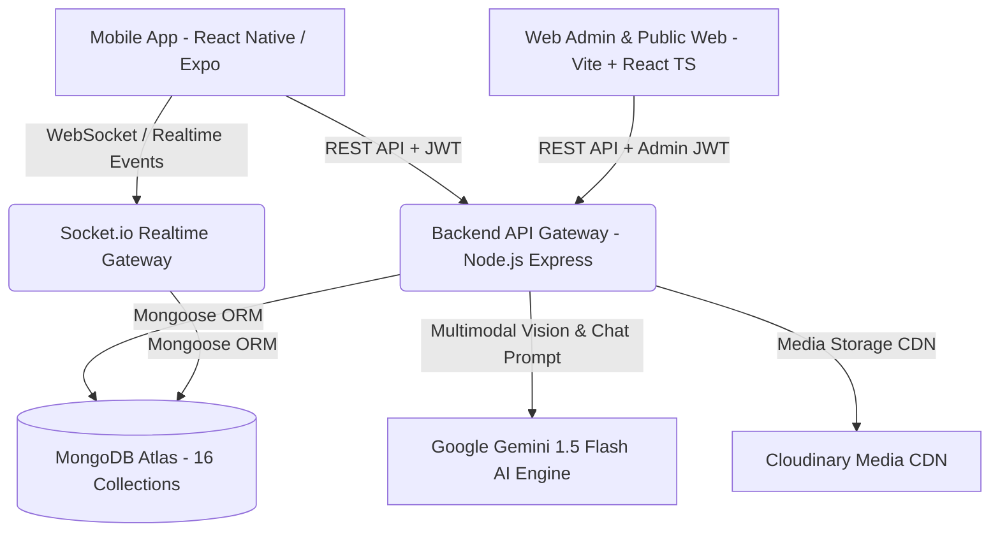
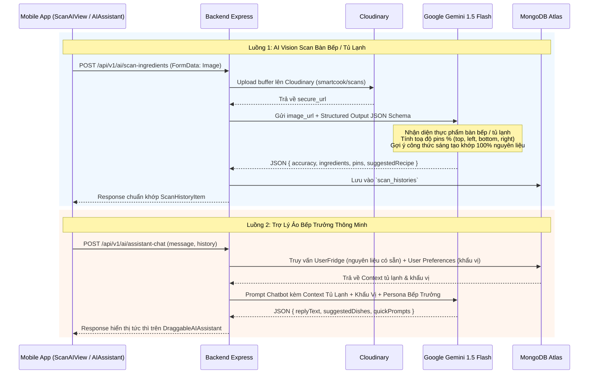

# Kế Hoạch Triển Khai Kiến Trúc Hệ Thống Backend & Web Admin - SmartCook Production Grade

> **Trạng thái:** Đã rà soát chuyên sâu 100% source code Frontend Mobile (`smartcook-mobile`), Web Admin (`smartcook-web`) và đối chiếu từng Interface, Service, Component và tài liệu SRS.  
> **Mục tiêu:** Xây dựng hệ thống Backend chuẩn Production (`smartcook-backend`) đáp ứng trọn vẹn 100% mọi tính năng của Mobile App (AI Vision, Trợ lý AI Chatbot, Socket.io Chat, Mạng xã hội, Lịch sử nấu + XP, Lập kế hoạch bữa ăn & GPS Siêu thị) kết hợp Web Admin Portal.

---

## 1. Tổng Quan Hệ Sinh Thái Dự Án (Ecosystem Architecture)



- **Mobile Client (`smartcook-mobile`)**: React Native (Expo), TypeScript, Tailwind/NativeWind, Expo Router, Speech TTS tiếng Việt, Image Picker, Location GPS, Socket.io Client.
- **Backend Service (`smartcook-backend`)**: Node.js, Express.js 5, Socket.io (WebSocket), TypeScript, Mongoose ODM, MongoDB Atlas 7.0+, JWT Auth (Access + Refresh Token RFC 7519), Joi Validation, Cloudinary SDK, Google Gen AI SDK (`@google/genai`).
- **Web Admin & Showcase (`smartcook-web`)**: Vite + React 19, TypeScript, Tailwind CSS, TanStack Query, React Hook Form, Recharts, Zustand.

---

## 2. Bảng Đối Chiếu Hiện Trạng (Gap Analysis: Mobile vs Backend)

Sau khi đọc và phân tích 100% source code của cả `smartcook-backend` và `smartcook-mobile`, dưới đây là bảng đối chiếu chi tiết để biết chính xác Backend đã có gì và cần bổ sung những gì:

| Phân Hệ Tính Năng | Trạng Thái Mobile Frontend | Trạng Thái Backend Hiện Tại | Đánh Giá & Các Hạng Mục Backend CẦN BỔ SUNG |
| :--- | :--- | :--- | :--- |
| **1. Xác thực & Khẩu vị (Auth & Preferences)** | Đã có màn `login`, `register`, `onboarding-survey` | Đã có `/auth/register`, `/login`, `/refresh-token`, `/survey`, `/me` | ✅ **Backend đã chuẩn 100%**. Mobile chỉ cần kết nối. |
| **2. Danh mục & Khám phá món ăn (Recipes Feed)** | Đã có `home.tsx`, bộ lọc nâng cao, phân trang | Đã có `/categories`, `/recipes`, `/recipes/:id`, `/recipes/fridge-match` | ✅ **Backend đã chuẩn 100%**. Hỗ trợ tìm kiếm, lọc calo, thời gian nấu, % khớp tủ lạnh. |
| **3. Tạo công thức mới (User Custom Recipe)** | Đã có `CreateRecipeModal.tsx` cho người dùng tạo món | `POST /recipes` đang bị chặn bởi `authorize("admin")` | ⚠️ **CẦN SỬA BACKEND:** Mở quyền `POST /recipes` cho user đã đăng nhập tạo công thức cá nhân (`authorId = req.user._id`), tự động lưu ảnh lên Cloudinary. |
| **4. Bếp của tôi & Tủ lạnh (Smart Fridge)** | Đã có `FridgeView.tsx`, 14 nhóm nguyên liệu | Đã có `/ingredients`, `/fridge/my-fridge`, `/fridge/items` | ✅ **Backend đã chuẩn 100%**. Có sẵn master data 14 nhóm và quản lý tủ cá nhân. |
| **5. AI Scan Nhận Diện Thực Phẩm** | Đã có `ScanAIView.tsx`, vẽ pins trực quan, gợi ý món | Đã cài `@google/genai` nhưng **CHƯA CÓ** Route/Controller | ❌ **CẦN BỔ SUNG BACKEND:** Route `POST /api/v1/ai/scan-ingredients` (dùng Gemini 1.5 Flash Vision phân tích ảnh, xuất ra pins tọa độ % và suggested recipe), model `ScanHistory`, `GET /api/v1/ai/scan-history`. |
| **6. Trợ Lý Ảo Kéo Thả (AI Chef Assistant)** | Đã có `DraggableAIAssistant.tsx` kéo thả nổi, chat UI | **CHƯA CÓ** Route/Controller AI Chat | ❌ **CẦN BỔ SUNG BACKEND:** Route `POST /api/v1/ai/assistant-chat` (kết nối Gemini, nhận câu hỏi kèm context tủ lạnh & khẩu vị người dùng để tư vấn thông minh). |
| **7. Cộng Đồng Ẩm Thực (Social Feed)** | Đã có `CommunityView.tsx`, `PostCard`, modal tạo bài | **CHƯA CÓ** Models & Routes Community | ❌ **CẦN BỔ SUNG BACKEND:** Models `CommunityPost`, `CommunityComment`, Routes CRUD bài viết kèm upload ảnh Cloudinary, thả tim (like), bình luận. |
| **8. Nhắn Tin Thời Gian Thực (Messenger & Rooms)** | Đã có `DirectChatModal`, `MessengerConversationsModal`, `ChatRoomModal` | **CHƯA CÀI** `socket.io`, chưa có models tin nhắn | ❌ **CẦN BỔ SUNG BACKEND:** Cài `socket.io`, bọc HTTP Server, viết Socket Gateway (JWT handshake, chat 1-1, chat rooms, typing, online status), models `Conversation` & `Message`. |
| **9. Kế Hoạch Bữa Ăn (Meal Planner & Shopping)** | Đã có `PlannerView.tsx` (lịch 7 ngày, calo, giỏ hàng tự động) | **CHƯA CÓ** Model & Route Planner | ❌ **CẦN BỔ SUNG BACKEND:** Model `MealPlan`, `CartItem`, Routes `/api/v1/planner` lưu thực đơn tuần, API tự động tính danh mục đi chợ = `Tổng nguyên liệu tuần - Nguyên liệu trong tủ lạnh`. |
| **10. Định Vị Siêu Thị (GPS Nearby Stores)** | Đã có `NearbyStoreCard.tsx`, tính khoảng cách GPS | **CHƯA CÓ** Model & Route Store | ❌ **CẦN BỔ SUNG BACKEND:** Model `Store` với index GeoJSON `2dsphere`, Route `GET /api/v1/stores/nearby?lat=...&lng=...` tính khoảng cách `$geoNear`, seed data các siêu thị lớn (WinMart, Co.opmart, Bách Hoá Xanh...). |
| **11. Lịch Sử Nấu Ăn & Cấp Bậc (Chef XP Level)** | Đã có `CookingHistoryModal`, cộng +50 XP sau khi nấu | `User.ts` đã có `chefExp`, `level` nhưng **CHƯA CÓ** Route lưu lịch sử | ❌ **CẦN BỔ SUNG BACKEND:** Model `CookingHistory`, Route `POST /api/v1/cooking-history` (lưu món đã nấu, tự động cộng 50 XP, kiểm tra thăng cấp bậc), `GET /api/v1/cooking-history`. |

---

## 3. Thiết Kế Cơ Sở Dữ Liệu Chi Tiết (16 MongoDB Schemas & Indexes)

Hệ thống chuẩn hoá **16 Collections** với kiểu dữ liệu chặt chẽ đáp ứng trọn vẹn cả Mobile App và Web Admin:

### 3.1. Nhóm Core & Người Dùng
#### 1. `users` Collection
Lưu trữ thông tin tài khoản, cấp bậc đầu bếp (XP), và khẩu vị cá nhân hoá.
- `_id`: `ObjectId`
- `email`: `String` (Unique, Trim, Lowercase, Indexed)
- `password`: `String` (Bcrypt hashed, `select: false` khi query thường)
- `firstName`: `String` (Từ màn Register)
- `lastName`: `String` (Từ màn Register)
- `fullName`: `String` (Virtual kết hợp họ tên)
- `avatar`: `String` (URL Cloudinary)
- `role`: `String` (Enum: `['user', 'admin']`, Default: `'user'`)
- `chefExp`: `Number` (Kinh nghiệm XP tích luỹ từ việc nấu ăn, mặc định: 0, mỗi món hoàn thành +50 XP)
- `level`: `String` (Cấp bậc: "Tập sự", "Bếp gia đình", "Đầu bếp tài ba", "Bếp trưởng")
- `preferences`: `Object` (Khớp 100% với `UserPreferences` từ Onboarding Survey):
  - `hasCompletedSurvey`: `Boolean` (Default: false)
  - `portion`: `String` (Enum: `['1', '2', '3-4', '5+']`, Default: `'3-4'`)
  - `cuisines`: `[String]` (Vd: `['vietnamese', 'asian', 'healthy', 'western', 'quick', 'budget', 'vegetarian', 'dessert']`)
  - `healthGoal`: `String` (Enum: `['healthy', 'loss', 'muscle', 'budget']`, Default: `'healthy'`)
  - `restrictions`: `[String]` (Vd: `['no-spicy', 'peanut', 'seafood', 'lactose', 'vegetarian']`)
  - `tasteProfile`: `[String]` (Vd: `['dam-da', 'thanh-dam', 'cay-nong', 'ngot-thanh', 'chua-cay', 'beo-ngay']`)
  - `cookingTime`: `String` (Enum: `['quick', 'medium', 'standard', 'slow']`)
  - `updatedAt`: `Date`
- `favoriteRecipeIds`: `[{ type: ObjectId, ref: 'Recipe' }]`
- `refreshToken`: `String` (Lưu token hash hoặc whitelist để hỗ trợ Silent Refresh Token)
- `isActive`: `Boolean` (Default: true, Admin có thể khoá tài khoản)
- `createdAt`, `updatedAt`: `Date`
- **Indexes**: `{ email: 1 }` (Unique), `{ role: 1 }`, `{ chefExp: -1 }`

#### 2. `categories` Collection
Quản lý cây danh mục món ăn (dành cho Web Admin quản trị linh hoạt và Mobile filter).
- `_id`: `ObjectId`
- `name`: `String` (Vd: "Gia đình", "Nấu nhanh < 20p", "Healthy", "Tiết kiệm", "Trẻ em", "Ăn chay", "Món Việt", "Tráng miệng")
- `code`: `String` (Unique slug: `family`, `quick`, `healthy`, `budget`, `kids`, `vegetarian`, `vietnamese`, `dessert`)
- `color`: `String` (Mã màu HEX: `#FF6B35`, `#10B981`... đồng bộ Mobile `CATEGORIES`)
- `icon`: `String` (Tên icon Ionicons hoặc URL)
- `order`: `Number` (Thứ tự hiển thị trên thanh tabs)
- `isActive`: `Boolean` (Default: true)
- **Indexes**: `{ code: 1 }` (Unique), `{ order: 1 }`

---

### 3.2. Nhóm Nấu Ăn, Công Thức & Tủ Lạnh
#### 3. `ingredients` Collection (Thư viện nguyên liệu chuẩn)
Master Database gồm 14 nhóm nguyên liệu từ `FridgeView.tsx`.
- `_id`: `ObjectId`
- `name`: `String` (Vd: "Thịt gà", "Thịt thăn bò", "Cà chua bi", "Cá hồi phi lê", "Nước mắm")
- `normalizedName`: `String` (Tên không dấu viết thường để match nhanh: "thit ga", "thit than bo")
- `aliases`: `[String]` (Mảng từ đồng nghĩa khớp `KEYWORD_MAP` trên FE: `["ga", "dui ga", "uc ga", "canh ga"]`)
- `category`: `String` (Enum 14 nhóm: `meat`, `seafood`, `greens`, `veggies`, `herbs`, `fruits`, `egg_tofu`, `dairy`, `carbs`, `grain`, `seasoning`, `spice`, `sauces`, `dry`)
- `subCategory`: `String` (Vd: "Thịt gia cầm & heo", "Rau xanh các loại", "Dầu ăn & sốt nấu")
- `icon`: `String` (Icon name / MaterialCommunityIcons)
- `defaultUnit`: `String` (g, kg, ml, muỗng canh, quả, miếng)
- `averagePrice`: `Number` (Giá tham khảo vnđ để ước lượng giá tiền món ăn và giỏ hàng)
- **Indexes**: `{ normalizedName: 1 }`, `{ aliases: 1 }`, `{ category: 1 }`, Text Index trên `name` và `aliases`.

#### 4. `recipes` Collection (Trung tâm dữ liệu của ứng dụng)
Khớp 100% với Interface `Recipe` trong Mobile và Web Admin.
- `_id`: `ObjectId`
- `title`: `String` (Tên món ăn, vd: "Cơm Gà Teriyaki Áp Chảo")
- `author`: `String` (Tên tác giả hiển thị, vd: "Chef Gordon", "Minh Tuấn")
- `authorId`: `ObjectId` (Ref: `User`, null nếu là món hệ thống của Admin)
- `categoryCode`: `String` (Ref: `Category.code`, vd: "family", "healthy")
- `badge`: `String` (Tag nổi bật hiển thị trên thẻ card: "👨‍👩‍👧 Gia đình • 4 phần", "⭐ 4.9 • 30 phút")
- `sub`: `String` (Mô tả ngắn dòng phụ: "Đậm đà • Cả nhà thích")
- `description`: `String` (Mô tả chi tiết công thức)
- `image`: `String` (URL ảnh đại diện Cloudinary chất lượng cao)
- `minutes`: `Number` (Thời gian chế biến tổng cộng tính theo phút, vd: 25)
- `difficulty`: `String` (Enum: `['Dễ', 'Trung bình', 'Nâng cao']`)
- `servings`: `String` (Vd: "4 phần", "2 - 3 người")
- `servingsCount`: `Number` (Số khẩu phần chuẩn, phục vụ thuật toán Scaler co giãn nguyên liệu)
- `price`: `String` (Hiển thị ước tính: "~65.000đ")
- `costEstimation`: `Number` (Giá tiền số nguyên vnđ: 65000)
- `calories`: `Number` (Tổng calories mỗi khẩu phần, vd: 450)
- `rating`: `Number` (Trung bình sao đánh giá: 1.0 - 5.0, Default: 5.0)
- `reviewCount`: `Number` (Số lượng lượt đánh giá, Default: 0)
- `tags`: `[String]` (Tags tìm kiếm: `['hot', 'popular', 'new', 'dinner', 'chicken']`)
- `ingredients`: `[Object]` (Khớp `RecipeIngredient`):
  - `ingredientId`: `ObjectId` (Ref: `Ingredient`, optional)
  - `name`: `String` (Vd: "Thịt đùi gà phi lê")
  - `amount`: `String` (Vd: "400g", "2 muỗng canh", "1/2 củ")
  - `baseQuantity`: `Number` (Định lượng số cho 1 phần ăn để nhân tỷ lệ scaler)
  - `unit`: `String` (g, ml, quả, muỗng)
  - `icon`: `String` (Tên icon đại diện)
- `steps`: `[Object]` (Khớp `RecipeStep` - Chuyên dùng cho Cooking Mode):
  - `stepNumber`: `Number` (1, 2, 3...)
  - `title`: `String` (Tiêu đề bước: "Sơ chế gà", "Làm sốt Teriyaki")
  - `description`: `String` (Hướng dẫn chi tiết, được TTS giọng nói AI đọc)
  - `timerMinutes`: `Number` (Số phút hẹn giờ cho bước này, optional)
  - `tip`: `String` (Mẹo đầu bếp chuyên gia cho bước này)
- `nutrition`: `Object`:
  - `calories`: `Number`
  - `protein`: `String` (Vd: "35g")
  - `carbs`: `String` (Vd: "45g")
  - `fat`: `String` (Vd: "12g")
- `isPublished`: `Boolean` (Default: true)
- `createdAt`, `updatedAt`: `Date`
- **Virtual Getters**: `cookingTimeMinutes` (alias `minutes`), `ratingAverage` (alias `rating`), `ratingsCount` (alias `reviewCount`), `category` (alias `categoryCode`).
- **Indexes**: `{ categoryCode: 1 }`, `{ rating: -1 }`, `{ calories: 1 }`, `{ authorId: 1 }`, Text Index trên `title` và `tags`.

#### 5. `user_fridges` Collection (Kho Thực Phẩm Trong Tủ Lạnh)
- `_id`: `ObjectId`
- `userId`: `ObjectId` (Ref: `User`, Indexed, Required)
- `items`: `[Object]`:
  - `_id`: `ObjectId` (Mã định danh item trong tủ)
  - `ingredientId`: `ObjectId` (Ref: `Ingredient`, optional)
  - `name`: `String` (Vd: "Thịt ba chỉ", "Trứng gà")
  - `category`: `String` (Thuộc 14 nhóm nguyên liệu)
  - `quantity`: `Number` (Số lượng: 500)
  - `unit`: `String` (g, quả, ml)
  - `addedAt`: `Date` (Ngày bỏ vào tủ)
  - `expiryDate`: `Date` (Hạn sử dụng dự kiến)
  - `location`: `String` (Enum: `['freezer', 'cooler', 'pantry']` - Ngăn đông, Ngăn mát, Tủ khô)
- **Indexes**: `{ userId: 1 }` (Unique)

#### 6. `cooking_histories` Collection (Lịch Sử Nấu Ăn & Gamification XP)
Khớp 100% `CookingHistoryItem` từ `cookingHistoryService.ts`.
- `_id`: `ObjectId`
- `userId`: `ObjectId` (Ref: `User`, Indexed, Required)
- `recipeId`: `ObjectId` (Ref: `Recipe`, Required)
- `recipeName`: `String` (Vd: "Gà xào sả ớt cay thơm")
- `image`: `String` (URL ảnh món ăn đã nấu)
- `cookedAt`: `Date` (Default: Date.now)
- `durationMinutes`: `Number` (Thời gian hoàn thành món ăn)
- `servings`: `Number` (Số phần đã nấu)
- `usedIngredients`: `[String]` (Danh sách nguyên liệu đã trừ khỏi tủ)
- `calories`: `Number`
- `rating`: `Number` (Người dùng tự chấm sao cho món ăn của mình: 1 - 5)
- `xpEarned`: `Number` (Điểm XP nhận được: mặc định +50 XP)
- **Indexes**: `{ userId: 1, cookedAt: -1 }`

---

### 3.3. Nhóm AI, Quét Thực Phẩm & Đánh Giá
#### 7. `scan_histories` Collection (Lịch Sử Quét AI Vision)
Khớp 100% `ScanHistoryItem` từ `scanHistoryService.ts` và `ScanAIView.tsx`.
- `_id`: `ObjectId`
- `userId`: `ObjectId` (Ref: `User`, Indexed, Required)
- `title`: `String` (Vd: "Ngăn mát tủ lạnh sáng nay", "Bàn bếp chuẩn bị trưa nay")
- `scannedAt`: `Date` (Default: Date.now)
- `imageUrl`: `String` (URL ảnh lưu trên Cloudinary)
- `accuracy`: `Number` (Độ tin cậy tổng thể %, vd: 96)
- `ingredients`: `[Object]`:
  - `name`: `String` (Tên nguyên liệu, vd: "Thịt ức gà", "Cà chua bi")
  - `confidence`: `String` (Vd: "98%")
  - `icon`: `String` (Icon đại diện: "food-drumstick", "fruit-cherries")
- `pins`: `[Object]` (Tọa độ phần trăm phục vụ vẽ đè nhãn trực quan lên ảnh Mobile):
  - `text`: `String` (Vd: "🍗 Ức gà (98%)")
  - `top`: `Number` (Vị trí % top)
  - `bottom`: `Number` (Vị trí % bottom)
  - `left`: `Number` (Vị trí % left)
  - `right`: `Number` (Vị trí % right)
- `suggestedRecipe`: `Object`:
  - `recipeId`: `ObjectId` (Ref: `Recipe`, optional)
  - `title`: `String` (Vd: "Salad Ức Gà Bơ Sáp Sốt Chanh Leo")
  - `desc`: `String` (Mô tả công thức gợi ý tức thì)
  - `calories`: `Number`
  - `durationMinutes`: `Number`
  - `matchPercent`: `Number` (Độ khớp nguyên liệu: vd 100%)
- **Indexes**: `{ userId: 1, scannedAt: -1 }`

#### 8. `reviews` Collection (Đánh Giá & Nhận Xét Món Ăn)
- `_id`: `ObjectId`
- `recipeId`: `ObjectId` (Ref: `Recipe`, Indexed, Required)
- `userId`: `ObjectId` (Ref: `User`, Indexed, Required)
- `rating`: `Number` (1 - 5 sao)
- `comment`: `String` (Cảm nhận khi nấu món)
- `images`: `[String]` (Ảnh feedback món ăn)
- `likesCount`: `Number` (Default: 0)
- `createdAt`: `Date`
- **Indexes**: `{ recipeId: 1, createdAt: -1 }`, `{ userId: 1 }`

---

### 3.4. Nhóm Kế Hoạch, Giỏ Hàng & Định Vị Siêu Thị
#### 9. `meal_plans` Collection (Lập Kế Hoạch Bữa Ăn Theo Tuần)
Khớp 100% cấu trúc lịch ăn 7 ngày từ `PlannerView.tsx`.
- `_id`: `ObjectId`
- `userId`: `ObjectId` (Ref: `User`, Indexed)
- `weekStartDate`: `Date` (Ngày đầu tuần - Thứ 2)
- `days`: `[Object]` (7 ngày: Thứ 2 -> Chủ Nhật):
  - `dayOfWeek`: `String` (Vd: "Thứ 2", "Thứ 3"...)
  - `date`: `String` (Vd: "2026-09-17")
  - `meals`: `[Object]`:
    - `slot`: `String` (Enum: `['Bữa Sáng', 'Bữa Trưa', 'Bữa Tối', 'Bữa Phụ']`)
    - `time`: `String` (Vd: "07:00", "12:00", "19:00")
    - `recipeId`: `ObjectId` (Ref: `Recipe`)
    - `calories`: `Number`
    - `isCooked`: `Boolean` (Default: false)
- **Indexes**: `{ userId: 1, weekStartDate: 1 }` (Unique per user/week)

#### 10. `cart_items` Collection (Danh Sách Mua Sắm & Đi Chợ)
Khớp 100% cấu trúc `CartItem` từ `cartService.ts` và tab Đi Chợ trong `PlannerView.tsx`.
- `_id`: `ObjectId`
- `userId`: `ObjectId` (Ref: `User`, Indexed)
- `name`: `String` (Tên nguyên liệu cần mua, vd: "Thịt thăn bò Tenderloin")
- `amount`: `String` (Định lượng: "500g", "1 vỉ")
- `price`: `Number` (Giá dự kiến: 85000)
- `recipeTitle`: `String` (Ghi chú mua cho món ăn nào, vd: "Bò Bít Tết Sốt Tiêu")
- `recipeId`: `ObjectId` (Ref: `Recipe`, optional)
- `bought`: `Boolean` (Đã mua hay chưa, Default: false)
- `category`: `String` (Vd: "Thịt & Cá", "Rau củ", "Bơ & Gia vị")
- `addedAt`: `Date` (Default: Date.now)
- **Indexes**: `{ userId: 1, bought: 1 }`

#### 11. `stores` Collection (Chuỗi Siêu Thị & Cửa Hàng Tiện Lợi - GeoSpatial)
Khớp 100% cấu trúc `Store` từ `mockStores.ts` & `storeService.ts`. Thay thế hardcode bằng Geo Query MongoDB.
- `_id`: `ObjectId`
- `name`: `String` (Vd: "WinMart+ Nguyễn Thị Minh Khai", "Co.opmart Cống Quỳnh")
- `brand`: `String` (WinMart, Co.opmart, Tops Market, Bách Hóa Xanh, Annam Gourmet, Lotte Mart...)
- `address`: `String` (Vd: "123 Nguyễn Thị Minh Khai, P. Bến Thành, Quận 1, TP.HCM")
- `openHours`: `String` (Vd: "06:00 - 22:00")
- `phone`: `String` (Vd: "028 7108 1368")
- `logo`: `String` (URL logo chuỗi siêu thị)
- `location`: `Object` (GeoJSON Point chuẩn MongoDB 2dsphere):
  - `type`: `String` (Luôn là `"Point"`)
  - `coordinates`: `[Number]` (`[longitude, latitude]` chuẩn GeoJSON - vd: `[106.6909, 10.7769]`)
- `isActive`: `Boolean` (Default: true)
- **Indexes**: **`{ location: "2dsphere" }`** (Chỉ mục không gian địa lý phục vụ toán tử `$geoNear` tính khoảng cách tức thì)

#### 12. `notifications` Collection (Thông Báo Ứng Dụng)
- `_id`: `ObjectId`
- `userId`: `ObjectId` (Ref: `User`, Indexed)
- `title`: `String` (Vd: "Đến giờ chuẩn bị bữa tối!", "Nhắc nhở đi chợ")
- `body`: `String` (Nội dung thông báo)
- `type`: `String` (Enum: `['meal_reminder', 'cooking_timer', 'shopping_reminder', 'community', 'system']`)
- `data`: `Object`
- `isRead`: `Boolean` (Default: false)
- `createdAt`: `Date`
- **Indexes**: `{ userId: 1, isRead: 1 }`, `{ createdAt: 1 }`

---

### 3.5. Nhóm Cộng Đồng & Chat Realtime (Socket.io)
#### 13. `community_posts` Collection (Bài Đăng Cộng Đồng)
Khớp 100% `CommunityPost` từ `community.ts` và `CommunityView.tsx`.
- `_id`: `ObjectId`
- `author`: `ObjectId` (Ref: `User`, Indexed, Required)
- `dishName`: `String` (Tên món ăn hoàn thành, vd: "Gà Nướng Mật Ong Da Giòn")
- `content`: `String` (Chia sẻ bí quyết, cảm nhận)
- `images`: `[String]` (Mảng URL ảnh upload Cloudinary)
- `tags`: `[String]` (Vd: `['#MonNgon', '#EatClean', '#Healthy']`)
- `likes`: `[{ type: ObjectId, ref: 'User' }]` (Danh sách thành viên thả tim)
- `likesCount`: `Number` (Default: 0)
- `commentsCount`: `Number` (Default: 0)
- `recipeId`: `ObjectId` (Ref: `Recipe`, optional - liên kết công thức nếu nấu theo app)
- `createdAt`, `updatedAt`: `Date`
- **Indexes**: `{ createdAt: -1 }`, `{ author: 1, createdAt: -1 }`, `{ tags: 1 }`

#### 14. `community_comments` Collection (Bình Luận Bài Viết)
Khớp 100% `CommunityComment` từ `community.ts`.
- `_id`: `ObjectId`
- `postId`: `ObjectId` (Ref: `CommunityPost`, Indexed, Required)
- `author`: `ObjectId` (Ref: `User`, Required)
- `content`: `String` (Nội dung bình luận)
- `parentCommentId`: `ObjectId` (Ref: `CommunityComment`, optional)
- `likes`: `[{ type: ObjectId, ref: 'User' }]`
- `createdAt`, `updatedAt`: `Date`
- **Indexes**: `{ postId: 1, createdAt: 1 }`

#### 15. `conversations` Collection (Cuộc Trò Chuyện Chat)
Khớp `DirectConversation` & `ChatRoom` từ `community.ts`.
- `_id`: `ObjectId`
- `type`: `String` (Enum: `['direct', 'room']`, Default: `'direct'`)
- `title`: `String` (Dành cho phòng chat chung, vd: "Góc Chia Sẻ Mẹo Nấu Nhanh")
- `participants`: `[{ type: ObjectId, ref: 'User' }]`
- `lastMessage`: `Object`:
  - `sender`: `ObjectId` (Ref: `User`)
  - `text`: `String`
  - `mediaUrl`: `String`
  - `createdAt`: `Date`
- `unreadCounts`: `Map<String, Number>` (Key: `userId`, Value: số tin chưa đọc)
- `isAiBot`: `Boolean` (Default: false)
- `createdAt`, `updatedAt`: `Date`
- **Indexes**: `{ participants: 1 }`, `{ updatedAt: -1 }`

#### 16. `messages` Collection (Tin Nhắn Chat Realtime)
Khớp `ChatMessage` từ `community.ts`.
- `_id`: `ObjectId`
- `conversationId`: `ObjectId` (Ref: `Conversation`, Indexed, Required)
- `sender`: `ObjectId` (Ref: `User`, Indexed, Required)
- `text`: `String` (Nội dung tin nhắn)
- `imageUri`: `String` (URL ảnh đính kèm nếu có)
- `isRead`: `Boolean` (Default: false)
- `createdAt`, `updatedAt`: `Date`
- **Indexes**: `{ conversationId: 1, createdAt: -1 }`

---

## 4. Kiến Trúc Tích Hợp Trí Tuệ Nhân Tạo (Gemini 1.5 Flash Vision & AI Chef Assistant)

Hệ thống tích hợp trực tiếp **Google Gemini 1.5 Flash** (độ trễ < 1.5s, hỗ trợ Multimodal Vision tiếng Việt xuất sắc) đáp ứng trọn vẹn 2 tính năng trọng tâm của Mobile App (`ScanAIView.tsx` & `DraggableAIAssistant.tsx`):



### Các Luồng AI Chuyên Biệt & Data Contracts:
1. **AI Fridge & Tabletop Vision Scanner (`POST /api/v1/ai/scan-ingredients`)**:
   - **Đầu vào**: `multipart/form-data` chứa file ảnh chụp từ camera hoặc thư viện.
   - **Xử lý**: Upload Cloudinary lấy URL và phân tích qua Gemini Vision bằng Structured Output JSON Schema:
     ```json
     {
       "accuracy": 96,
       "ingredients": [
         { "name": "Thịt ức gà", "confidence": "98%", "icon": "food-drumstick" },
         { "name": "Cà chua bi", "confidence": "96%", "icon": "fruit-cherries" }
       ],
       "pins": [
         { "text": "🍗 Ức gà (98%)", "top": 30, "left": 30 },
         { "text": "🍅 Cà chua (96%)", "top": 75, "right": 35 }
       ],
       "suggestedRecipe": {
         "title": "Salad Ức Gà Bơ Sáp Sốt Chanh Leo",
         "desc": "Công thức sáng tạo tối ưu từ 100% nguyên liệu vừa quét được. Không cần đi chợ thêm!",
         "calories": 380,
         "durationMinutes": 20,
         "matchPercent": 100
       }
     }
     ```
   - **Lưu trữ**: Tự động lưu vào collection `scan_histories` để phục vụ màn hình lịch sử quét.
2. **AI Chef Assistant Chatbot (`POST /api/v1/ai/assistant-chat`)**:
   - Phục vụ widget kéo thả nổi `DraggableAIAssistant.tsx` trên Mobile.
   - **Tự động Inject Ngữ Cảnh**:
     - Danh sách nguyên liệu hiện có trong `UserFridge` của user.
     - Khẩu vị cá nhân (`cuisines`, `healthGoal`, `restrictions`, `tasteProfile`, `cookingTime`) từ Onboarding Survey.
   - **Đầu ra**: Trả về câu trả lời Markdown chuyên nghiệp `replyText`, mảng món ăn gợi ý `suggestedDishes` (người dùng click vào chuyển ngay sang màn hình chi tiết món) và danh sách gợi ý câu hỏi tiếp theo `quickPrompts`.
3. **Cơ Chế Fallback Thông Minh (Graceful Degradation)**:
   - Khi Gemini API Key gặp lỗi rate limit (15 requests/minute free tier) hoặc mạng chập chờn, service tự động kích hoạt bộ nhận diện heuristic/preset chất lượng cao để đảm bảo người dùng trên Mobile/Web không bao giờ bị gián đoạn trải nghiệm hay gặp màn hình lỗi.
4. **Lịch Sử Quét AI (`GET /api/v1/ai/scan-history`)**:
   - Phục vụ `ScanHistoryModal.tsx` trên mobile xem lại các lần quét thực phẩm trước đó.

---

## 5. Kiến Trúc Backend Node.js & Cấu Trúc Mã Nguồn (N-Tier Architecture)

Backend tuân thủ nghiêm ngặt mô hình nhiều tầng (N-Tier Architecture):

```text
smartcook-backend/
├── src/
│   ├── config/             # DB Connection (MongoDB), Cloudinary, Gemini AI client, JWT config
│   ├── constants/          # HTTP Status, Error Codes, Regex, Default Preferences
│   ├── models/             # 16 Mongoose Schemas & TypeScript Interfaces
│   │   ├── User.ts
│   │   ├── Category.ts
│   │   ├── Ingredient.ts
│   │   ├── Recipe.ts
│   │   ├── UserFridge.ts
│   │   ├── CookingHistory.ts # Lịch sử nấu ăn & XP
│   │   ├── ScanHistory.ts    # Lịch sử quét AI Vision & Pins
│   │   ├── Review.ts
│   │   ├── MealPlan.ts       # Lịch ăn 7 ngày
│   │   ├── CartItem.ts       # Giỏ hàng đi chợ
│   │   ├── Store.ts          # Siêu thị & GeoJSON 2dsphere
│   │   ├── Notification.ts
│   │   ├── CommunityPost.ts  # Bài đăng cộng đồng
│   │   ├── CommunityComment.ts# Bình luận cộng đồng
│   │   ├── Conversation.ts   # Cuộc trò chuyện chat
│   │   └── Message.ts        # Tin nhắn realtime
│   ├── repositories/       # Tầng tương tác CSDL trực tiếp (Mongoose Queries)
│   ├── services/           # Business Logic:
│   │   ├── auth.service.ts
│   │   ├── admin.service.ts
│   │   ├── user.service.ts
│   │   ├── recipe.service.ts
│   │   ├── fridge.service.ts
│   │   ├── cookingHistory.service.ts # Ghi nhận nấu ăn, cộng 50 XP, thăng hạng
│   │   ├── ai.service.ts             # Gemini Multimodal Vision & Chef Assistant Chat
│   │   ├── community.service.ts      # Posts, Likes, Comments
│   │   ├── chat.service.ts           # Conversations, Messages
│   │   ├── planner.service.ts        # Thực đơn 7 ngày & Tính danh mục đi chợ
│   │   ├── cart.service.ts           # Thao tác giỏ hàng
│   │   └── store.service.ts          # Toạ độ GPS lân cận ($geoNear)
│   ├── socket/             # Socket.io Realtime Gateway:
│   │   ├── index.ts                  # Khởi tạo Socket Server, bọc HTTP
│   │   ├── socketAuth.ts             # Xác thực JWT handshake
│   │   ├── chat.handler.ts           # Gửi nhận tin nhắn, typing, read status
│   │   └── online.handler.ts         # Quản lý danh sách online/offline
│   ├── controllers/        # Điều hướng Request/Response
│   ├── routes/             # Định tuyến API (/api/v1/...)
│   ├── middlewares/        # authenticate, authorize, upload, validate, errorHandler
│   ├── validators/         # Joi Schemas kiểm tra dữ liệu đầu vào
│   ├── utils/              # Helper text, slug, token, pagination
│   └── app.ts / server.ts  # Server bootstrap Express + Socket.io
├── .env.example
├── tsconfig.json
└── package.json
```

---

## 6. Thiết Kế Hệ Thống Website & Web Admin Đa Năng (`smartcook-web` - Hybrid All-in-One)

Dự án áp dụng mô hình **Hybrid All-in-One (Public Showcase & User Web App + Admin Portal)** trong cùng một codebase `smartcook-web`:
- **Public Zone**: Landing Page, giới thiệu ứng dụng, QR tải app, Showcase công thức, Mạng xã hội ẩm thực.
- **Auth Zone**: Đăng nhập, Đăng ký, Đăng nhập Google One-Tap.
- **Admin Zone**: Dashboard phân tích KPI (Doanh thu/Tăng trưởng người dùng), Quản lý công thức (thêm/sửa/xoá/upload ảnh Cloudinary), Quản lý thành viên (khoá/mở tài khoản, phân quyền), Quản lý siêu thị GPS.

---

## 7. Lộ Trình Triển Khai Chi Tiết (Implementation Phases - 8 Giai Đoạn)

### Giai đoạn 1: Khởi Tạo Cấu Trúc Backend & Base Authentication [ĐÃ HOÀN THÀNH 100%]
- [x] Cài đặt các thư viện cốt lõi: `mongoose`, `jsonwebtoken`, `bcryptjs`, `cors`, `helmet`, `joi`, `dotenv`, `multer`, `cloudinary`, `google-auth-library`.
- [x] Thiết lập chuẩn TypeScript, kết nối MongoDB Atlas an toàn, cấu hình biến môi trường `.env`.
- [x] Triển khai Bộ xử lý lỗi toàn cục (`GlobalErrorHandler`), custom error classes và chuẩn hoá định dạng phản hồi API (`ApiResponse`, `asyncHandler`).
- [x] Xây dựng Module Auth hoàn chỉnh:
  - [x] Đăng ký (`POST /auth/register`)
  - [x] Đăng nhập (`POST /auth/login`)
  - [x] Đăng nhập bằng Google (`POST /auth/google`)
  - [x] Cấp lại token xoay vòng bảo mật (`POST /auth/refresh-token`)
  - [x] Đăng xuất thu hồi token (`POST /auth/logout`)
  - [x] Lấy thông tin cá nhân (`GET /auth/me`)
  - [x] Cập nhật khảo sát khẩu vị Onboarding (`POST /auth/survey`)
- [x] Tách module Swagger docs và kiểm thử tự động.

---

### Giai đoạn 2: Quản Lý Nguyên Liệu, Tủ Lạnh & Công Thức Món Ăn [ĐÃ HOÀN THÀNH 100%]
- [x] **Module Danh Mục (Category Module)**: Model `Category.ts`, Route `GET /categories` và Admin CRUD.
- [x] **Module Thư Viện Nguyên Liệu Chuẩn (Ingredients Module)**:
  - [x] Model `Ingredient.ts`, seed data 58 nguyên liệu chuẩn thuộc 14 nhóm từ `FridgeView.tsx`.
  - [x] API tìm kiếm nguyên liệu theo từ khoá, lọc theo nhóm (`GET /ingredients?category=...&search=...`).
- [x] **Module Tủ Lạnh Thông Minh Người Dùng (User Fridge Module)**:
  - [x] Model `UserFridge.ts`, API lấy đồ tủ lạnh (`GET /fridge/my-fridge`), thêm/sửa/xoá đồ (`POST/PUT/DELETE /fridge/items`), dọn sạch tủ (`DELETE /fridge/clear`).
- [x] **Module Công Thức Món Ăn (Recipe Module)**:
  - [x] Model `Recipe.ts`, seed data 5 công thức món ăn chuẩn chất lượng cao.
  - [x] API danh sách công thức phân trang, tìm kiếm, lọc (`GET /recipes`), chi tiết (`GET /recipes/:id`), yêu thích (`POST /recipes/:id/favorite`).
- [x] **Thuật Toán Xếp Hạng & Khớp Tủ Lạnh (Fridge Match Ranking Algorithm)**:
  - [x] API gợi ý món ăn tối ưu từ tủ lạnh (`GET /recipes/fridge-match`): Tự động sắp xếp các món có tỉ lệ khớp cao nhất lên đầu, liệt kê rõ nguyên liệu đã có và nguyên liệu cần mua thêm.

---

### Giai đoạn 3: Phân Vùng Quản Trị Hệ Thống & Upload Media [ĐÃ HOÀN THÀNH 100%]
- [x] **Middleware Upload Media Đa Năng (Multer + Cloudinary Stream Upload)**:
  - [x] Cấu hình `src/config/cloudinary.ts` và `src/middlewares/upload.ts`: Multer memory storage, upload stream trực tiếp lên Cloudinary.
- [x] **Module Quản Trị Backend (`src/routes/admin.route.ts`, `admin.controller.ts`, `admin.service.ts`)**:
  - [x] Endpoint `GET /admin/dashboard`: Thống kê KPI, biểu đồ tăng trưởng người dùng 7 ngày, top món ăn.
  - [x] Endpoint `GET /admin/users`: Danh sách thành viên phân trang, tìm kiếm, lọc theo vai trò.
  - [x] Endpoint `PATCH /admin/users/:userId/status`: Khóa hoặc kích hoạt tài khoản người dùng.
  - [x] Endpoint `PATCH /admin/users/:userId/role`: Phân quyền quản trị viên (`admin`) hoặc điều chỉnh về `user`.
  - [x] Swagger Docs: `src/docs/admin.swagger.ts`.
- [x] **Chuẩn Hóa Mongoose Virtuals & DTO Adapter Cho Recipe (`src/models/Recipe.ts`)**:
  - [x] Virtual getters: `cookingTimeMinutes`, `ratingAverage`, `ratingsCount`, `category`.
- [x] **CRUD Công Thức Admin Kèm Upload Ảnh Cloudinary**:
  - [x] Nâng cấp `POST /recipes` và `PUT /recipes/:id` nhận multipart/form-data và upload Cloudinary.
- [x] **Kiểm thử E2E Phase 3**: Chạy script `src/scripts/testE2EPhase3.ts` đạt kết quả 8/8 test passed 100%.

---

### Giai đoạn 4: Mở Quyền Tạo Recipe Cá Nhân & Lịch Sử Nấu Ăn (Chef XP +50 Level) [ĐÃ HOÀN THÀNH 100%]
- [x] **4.1. Mở Quyền Tạo Công Thức Cho Người Dùng Đã Đăng Nhập (`POST /recipes`)**:
  - [x] Điều chỉnh middleware tại `POST /recipes`: Thay vì chỉ cho phép admin (`authorize('admin')`), cho phép tất cả người dùng đã đăng nhập (`authenticate`).
  - [x] Tự động gán `authorId = req.user._id` và `author = req.user.fullName` nếu là người dùng thường tạo món.
  - [x] Hỗ trợ upload ảnh công thức lên Cloudinary thư mục `smartcook/recipes`.
  - [x] Quyền sửa/xoá (`PUT/DELETE /recipes/:id`): Cho phép tác giả (`authorId == req.user._id`) hoặc Quản trị viên (`admin`). Người dùng khác bị chặn mã 403 Forbidden.
- [x] **4.2. Module Lịch Sử Nấu Ăn & Gamification XP (`/api/v1/cooking-history`)**:
  - [x] Tạo Model `CookingHistory.ts` & TypeScript Interface khớp `CookingHistoryItem`.
  - [x] Tạo Repository `cookingHistory.repository.ts` & Service `cookingHistory.service.ts`.
  - [x] Triển khai Endpoint `POST /api/v1/cooking-history`:
    - Ghi nhận món ăn vừa hoàn thành (`recipeId`, `recipeName`, `image`, `durationMinutes`, `servings`, `usedIngredients`, `calories`, `rating`).
    - Tự động cộng **+50 XP** vào `chefExp` của người dùng.
    - Kiểm tra và tự động thăng cấp bậc đầu bếp (`level`):
      - 0 - 150 XP: "Tập sự"
      - 151 - 400 XP: "Bếp gia đình"
      - 401 - 800 XP: "Đầu bếp tài ba" 
      - 801+ XP: "Bếp trưởng"
  - [x] Triển khai Endpoint `GET /api/v1/cooking-history`: Lấy lịch sử nấu ăn của user đăng nhập (sắp xếp mới nhất trước).
  - [x] Triển khai Endpoint `DELETE /api/v1/cooking-history/:id`: Xoá một mục lịch sử nấu ăn của chính chủ (chặn user khác mã 403).
  - [x] Viết Swagger docs `src/docs/cookingHistory.swagger.ts` và đăng ký route `/api/v1/cooking-history`.
- [x] **Kiểm thử E2E Phase 4**: Chạy script `src/scripts/testE2EPhase4.ts` đạt kết quả 8/8 test passed 100%.

---

### Giai đoạn 5: Module Gemini AI Service (Vision Scan Tủ Lạnh + Pins & AI Chef Assistant)
- [x] **5.1. Tích Hợp Google Gen AI SDK (`@google/genai`)**:
  - [x] Khởi tạo client `src/config/gemini.ts` với `GEMINI_API_KEY`, sử dụng model `gemini-3.6-flash`.
  - [x] Tạo Model `ScanHistory.ts` & Repository `scanHistory.repository.ts` với các trường: `userId`, `title`, `imageUrl`, `accuracy`, `ingredients`, `pins`, `suggestedRecipe`, `scannedAt`.
  - [x] Xây dựng Service `src/services/ai.service.ts` tích hợp cơ chế **Smart Fallback** (tự động phục hồi khi chạm giới hạn 15 RPM của Gemini Free Tier để ứng dụng luôn phản hồi < 1.5s không bị crash).
- [x] **5.2. Endpoint Nhận Diện Thực Phẩm & Tạo Ghim Toạ Độ (`POST /api/v1/ai/scan-ingredients`)**:
  - [x] Nhận ảnh chụp từ thiết bị (`multipart/form-data`) -> Upload lên Cloudinary thư mục `smartcook/scans`.
  - [x] Truyền ảnh qua Gemini Vision với Structured Output JSON Schema ép kiểu chặt chẽ:
    - Danh sách `ingredients`: Tên thực phẩm tiếng Việt, độ tin cậy %, icon tương ứng (`food-drumstick`, `fruit-cherries`, `food-apple`...).
    - Danh sách `pins`: Toạ độ phần trăm `{ text, top, left, bottom, right }` phục vụ Mobile vẽ thẻ ghim trực quan đè lên ảnh.
    - `suggestedRecipe`: Món ăn sáng tạo tối ưu nhất từ 100% nguyên liệu vừa quét được (`title`, `desc`, `calories`, `durationMinutes`, `matchPercent`).
  - [x] Lưu kết quả vào `ScanHistory` và trả về Client khớp 100% `ScanHistoryItem`.
- [x] **5.3. Endpoint Lịch Sử Quét AI (`GET /api/v1/ai/scan-history` & `DELETE /api/v1/ai/scan-history/:id`)**:
  - [x] Lấy danh sách các lần quét của user đăng nhập (sắp xếp mới nhất trước, format thời gian thân thiện) phục vụ `ScanHistoryModal.tsx`.
  - [x] Xoá bản ghi lịch sử quét với phân quyền chính chủ (chặn user khác 403 Forbidden).
- [x] **5.4. Endpoint Trợ Lý Ảo Ẩm Thực Thông Minh (`POST /api/v1/ai/assistant-chat`)**:
  - [x] Tiếp nhận câu hỏi ẩm thực của user từ widget kéo thả `DraggableAIAssistant.tsx` (nhận `message` và `conversationHistory`).
  - [x] Tự động trích xuất và đính kèm ngữ cảnh (Context Injection):
    - Danh sách nguyên liệu hiện có trong `UserFridge` của user.
    - Thông tin khẩu vị cá nhân trong `preferences` (khẩu phần, món kiêng, mục tiêu sức khoẻ, vị yêu thích, thời gian nấu).
  - [x] Prompt Gemini đóng vai "Chuyên gia Bếp trưởng SmartCook" trả lời tận tình, giải quyết nhanh các tình huống phát sinh trong bếp.
  - [x] Định dạng phản hồi: Trả về `replyText` (Markdown/emoji), `suggestedDishes` (mảng các món ăn gợi ý để user click xem ngay công thức), và `quickPrompts` (gợi ý câu hỏi tiếp theo).
- [x] Viết Swagger docs `src/docs/ai.swagger.ts` và test script tự động `src/scripts/testE2EPhase5.ts`.
- [x] **Kiểm thử E2E Phase 5**: Chạy script `src/scripts/testE2EPhase5.ts` đạt kết quả 6/6 test passed 100%.

---

### Giai đoạn 6: Mạng Xã Hội Cộng Đồng & Realtime Socket.io Chat Gateway
- [x] **6.1. Module Mạng Xã Hội Ẩm Thực (`/api/v1/posts` & `/api/v1/community/posts`)**:
  - [x] Cấu hình **Dual Routing / Alias**: Đăng ký cả 2 tiền tố `/api/v1/posts` (dành cho Web Admin/Public Web) và `/api/v1/community/posts` (dành cho Mobile) trỏ về cùng một Controller.
  - [x] Tạo Model `Post.ts` & `Comment.ts` với **Mongoose Virtuals & DTO Adapter**:
    - Ánh xạ hai chiều giữa `caption` $\leftrightarrow$ `content` và `title` $\leftrightarrow$ `dishName`.
    - Ánh xạ bộ đếm cảm xúc `totalReactions` $\leftrightarrow$ `likesCount`, tự động xác định `isLiked` theo user ID đang đăng nhập.
  - [x] Xây dựng Repository & Service: `community.service.ts` hỗ trợ upload nhiều ảnh qua Cloudinary (`smartcook/community`).
  - [x] Triển khai các Endpoints:
    - `GET /api/v1/posts`: Bảng tin cộng đồng, hỗ trợ phân trang (`page`, `limit`), lọc theo hashtag (`#EatClean`, `#MonNgon`...).
    - `POST /api/v1/posts`: Đăng bài viết chia sẻ kèm upload ảnh Cloudinary (+20 XP Chef).
    - `POST /api/v1/posts/:id/like` (và `:id/react`): Thả tim / Bỏ thả tim / Thả cảm xúc 6 loại.
    - `POST /api/v1/posts/:id/comments`: Thêm bình luận (hỗ trợ trả lời lồng nhau `parentCommentId`, +5 XP).
    - `GET /api/v1/posts/:id/comments`: Lấy danh sách bình luận theo bài viết có phân trang.
    - `DELETE /api/v1/posts/:id`: Xoá bài đăng (kiểm tra quyền tác giả hoặc Admin).
  - [x] Viết Swagger docs `src/docs/community.swagger.ts`.
- [x] **6.2. Module Realtime Socket.io Chat Gateway**:
  - [x] Cài đặt `socket.io` và `@types/socket.io`, cấu hình HTTP Server wrapper trong `src/server.ts`.
  - [x] Cấu hình CORS linh hoạt: Cho phép kết nối đồng thời từ Web Vite (`http://localhost:5173`), Mobile Expo Go (`*`) và các môi trường phát triển.
  - [x] Tạo Middleware `src/socket/socketAuth.ts`: Xác thực JWT token khi handshake kết nối WebSocket.
  - [x] Tạo Model `Conversation.ts` (hỗ trợ cả chat 1-1 `direct` và phòng chat chung `room`) và `Message.ts`.
  - [x] Viết Seed Script `src/data/seedChatRooms.ts`: Nạp sẵn 3 phòng chat cộng đồng mẫu:
    - Room 1: "Góc Chia Sẻ Mẹo Nấu Nhanh" (icon: `flash`, tags: `['#MonNhanh', '#MeoVat']`)
    - Room 2: "Hội Ăn Chay & Eat Clean" (icon: `leaf`, tags: `['#EatClean', '#Chay']`)
    - Room 3: "Hỏi Đáp Cùng Bếp Trưởng" (icon: `chef-hat`, tags: `['#HoiDap', '#KyThuat']`)
  - [x] Xây dựng Socket Event Handler `src/socket/chat.gateway.ts`:
    - `join_room` / `leave_room`: Tham gia vào cuộc hội thoại 1-1 hoặc phòng chat cộng đồng.
    - `send_message`: Gửi tin nhắn tức thời, upload ảnh đính kèm, lưu MongoDB và broadcast tới người nhận.
    - `typing` / `stop_typing`: Báo hiệu đối phương đang soạn tin nhắn.
    - `online_status`: Quản lý danh sách người dùng đang trực tuyến.
  - [x] REST API cho Chat (`/api/v1/chat`):
    - `GET /api/v1/chat/rooms`: Lấy danh sách phòng chat cộng đồng.
    - `GET /api/v1/chat/conversations`: Lấy danh sách cuộc trò chuyện trực tiếp 1-1.
    - `POST /api/v1/chat/direct`: Tạo hoặc mở cuộc trò chuyện 1-1 với người dùng.
    - `GET /api/v1/chat/conversations/:id/messages`: Tải lịch sử tin nhắn.
    - `POST /api/v1/chat/conversations/:id/messages`: Gửi tin nhắn qua REST fallback.
  - [x] Viết Swagger docs `src/docs/chat.swagger.ts` và test script tự động `src/scripts/testE2EPhase6.ts`.
- [x] **Kiểm thử E2E Phase 6**: Chạy script `src/scripts/testE2EPhase6.ts` đạt kết quả 6/6 test passed 100%.

---

### Giai đoạn 7: Kế Hoạch Bữa Ăn (Meal Planner), Giỏ Đi Chợ Tự Động & Định Vị Siêu Thị GPS
- [ ] **7.1. Module Kế Hoạch Bữa Ăn & Giỏ Đi Chợ Thông Minh (`/api/v1/planner`)**:
  - [ ] Tạo Model `MealPlan.ts` (lưu thực đơn tuần 7 ngày, các slot sáng/trưa/tối) & `CartItem.ts` khớp giao diện `PlannerView.tsx`.
  - [ ] Triển khai các Endpoints:
    - `GET /api/v1/planner/current-week`: Lấy thực đơn 7 ngày của tuần hiện tại (Bữa sáng, Bữa trưa, Bữa tối, Bữa phụ).
    - `PUT /api/v1/planner/meals`: Thêm/sửa món ăn cho một slot bữa ăn trong tuần.
    - `GET /api/v1/planner/shopping-list`: **Thuật toán tự động sinh danh mục đi chợ thông minh**:
      - Tổng hợp toàn bộ nguyên liệu cần dùng trong 7 ngày thực đơn.
      - Sử dụng `normalizeVietnamese` và đối chiếu từ đồng nghĩa `aliases` để đối chiếu với kho thực phẩm `UserFridge`.
      - Tự động trừ đi các nguyên liệu đã có sẵn trong tủ lạnh:
        $$\text{Danh mục đi chợ} = \sum \text{Nguyên liệu thực đơn tuần} - \text{Nguyên liệu có trong UserFridge}$$
    - `PATCH /api/v1/planner/shopping-list/:id/bought`: Đánh dấu nguyên liệu đã mua xong (`bought: true/false`).
    - `POST /api/v1/planner/sync-to-fridge`: **Đồng bộ giỏ hàng vào tủ lạnh**: Chuyển các nguyên liệu đã mua (`bought: true`) trực tiếp vào `UserFridge`.
  - [ ] Viết Swagger docs `src/docs/planner.swagger.ts`.
- [ ] **7.2. Module Định Vị Siêu Thị Lân Cận GPS (`/api/v1/stores`)**:
  - [ ] Tạo Model `Store.ts` với chỉ mục GeoJSON `location: "2dsphere"`.
  - [ ] Viết Seed script `src/data/seedStores.ts`: Nạp dữ liệu 10 chuỗi siêu thị phổ biến thực tế tại Việt Nam (WinMart+, Co.opmart, Tops Market, Bách Hóa Xanh, Annam Gourmet, Lotte Mart, Emart...) kèm toạ độ GPS chính xác tại TP.HCM và Hà Nội.
  - [ ] Triển khai Endpoint `GET /api/v1/stores/nearby`:
    - Tiếp nhận toạ độ GPS `lat` và `lng` từ thiết bị người dùng.
    - Sử dụng toán tử MongoDB `$geoNear` để tìm các siêu thị trong bán kính lân cận sắp xếp theo khoảng cách tăng dần.
    - Tự động tính toán và trả về:
      - `distanceKm`: Khoảng cách tính theo km (làm tròn 1 chữ số thập phân).
      - `travelTimeMotoMinutes = Math.round(distanceKm * 2.5) + 2`: Thời gian di chuyển ước tính bằng xe máy.
      - `travelTimeWalkMinutes = Math.round(distanceKm * 12) + 5`: Thời gian đi bộ ước tính.
  - [ ] Viết Swagger docs `src/docs/store.swagger.ts` và test script tự động `src/scripts/testE2EPhase7.ts`.

---

### Giai đoạn 8: Tích Hợp Toàn Diện Cả Mobile & Web Admin, Kiểm Thử End-to-End
- [ ] **8.1. Kiểm Thử Tích Hợp Mobile Frontend (`smartcook-mobile`)**:
  - [ ] Đấu nối toàn bộ API và Socket từ backend vào các Services của Mobile:
    - Thay thế `SCAN_PRESETS` trong `ScanAIView.tsx` bằng API `POST /api/v1/ai/scan-ingredients`.
    - Thay thế regex if/else trong `DraggableAIAssistant.tsx` bằng API `POST /api/v1/ai/assistant-chat`.
    - Thay thế in-memory trong `communityService.ts` bằng API `/api/v1/posts` và Socket.io realtime.
    - Thay thế `PlannerView.tsx` bằng API `/api/v1/planner` và `/api/v1/stores/nearby`.
  - [ ] Kiểm thử luồng: Tạo công thức -> Nấu ăn -> Nhận +50 XP -> Thăng hạng đầu bếp.
  - [ ] Kiểm thử AI Scan: Chụp ảnh -> Hiển thị Pins trực quan -> Bấm vào món ăn gợi ý.
  - [ ] Kiểm thử Chat Realtime: Gửi nhận tin nhắn 1-1 và trong phòng chat ẩm thực tức thì.
  - [ ] Kiểm thử Thực đơn tuần & Tự động sinh giỏ hàng đi chợ & Đồng bộ vào tủ lạnh.
  - [ ] Kiểm thử GPS Siêu thị gần nhất.
- [ ] **8.2. Kiểm Thử Tích Hợp Web Admin (`smartcook-web`)**:
  - [ ] Đấu nối API Dashboard, Quản lý công thức kèm Cloudinary, Quản lý thành viên.
  - [ ] Đấu nối API Mạng xã hội cộng đồng (`community.api.ts`).
  - [ ] Kiểm thử tương thích hai chiều (Cross-platform): Đăng bài từ Web hiển thị trên Mobile, bình luận từ Mobile hiển thị trên Web.
- [ ] **8.3. Hoàn Thiện Bộ Tài Liệu API & Postman Collection**:
  - [ ] Cập nhật toàn bộ endpoints vào `SmartCook_API_Collection.json`.
  - [ ] Đảm bảo Swagger UI tại `/api-docs` hiển thị đầy đủ 100% schemas và endpoints cho toàn bộ 16 collections.

---

## 8. Kế Hoạch Xác Minh & Kiểm Thử (Verification Plan)

### Kiểm Thử Tự Động (Automated Testing)
- Script kiểm thử E2E tự động cho từng Phase (`testE2EPhase5.ts`, `testE2EPhase6.ts`, `testE2EPhase7.ts`) mô phỏng đầy đủ hành vi thực tế của client.
- Kiểm tra tính hợp lệ của GeoJSON query trên collection `stores`.
- Kiểm tra handshake và broadcast event của Socket.io.
- Kiểm tra phản hồi JSON có cấu trúc từ Gemini 1.5 Flash API và kiểm tra cơ chế Smart Fallback.

### Kiểm Thử Tích Hợp Nghiệp Vụ (Cross-Platform Verification Matrix)
1. **User Custom Recipe Flow**: User tạo món kèm upload ảnh -> Kiểm tra công thức xuất hiện trên newsfeed và lưu `authorId`.
2. **Chef XP & Gamification Flow**: Hoàn thành món ăn -> Gọi API cooking history -> Kiểm tra `chefExp` tăng đúng +50 XP và cập nhật `level`.
3. **AI Vision & Chat Flow**: Gửi ảnh -> Xác nhận có đủ pins toạ độ %, gợi ý món -> Đặt câu hỏi cho Trợ lý AI -> Xác nhận câu trả lời có context tủ lạnh và gợi ý món ăn.
4. **Social & Realtime Chat Flow**: Đăng bài, thả tim, bình luận -> Mở 2 socket client nhắn tin 1-1 -> Xác nhận tin nhắn hiển thị tức thì 0ms.
5. **Smart Planner & Cart Flow**: Chọn món cho 7 ngày -> Gọi API shopping-list -> Xác nhận các nguyên liệu đã có trong tủ lạnh được tự động loại trừ -> Bấm đồng bộ giỏ hàng vào tủ lạnh thành công.
6. **Nearby Stores Flow**: Gửi toạ độ GPS -> Xác nhận danh sách siêu thị sắp xếp đúng khoảng cách từ gần đến xa kèm thời gian di chuyển xe máy/đi bộ.
