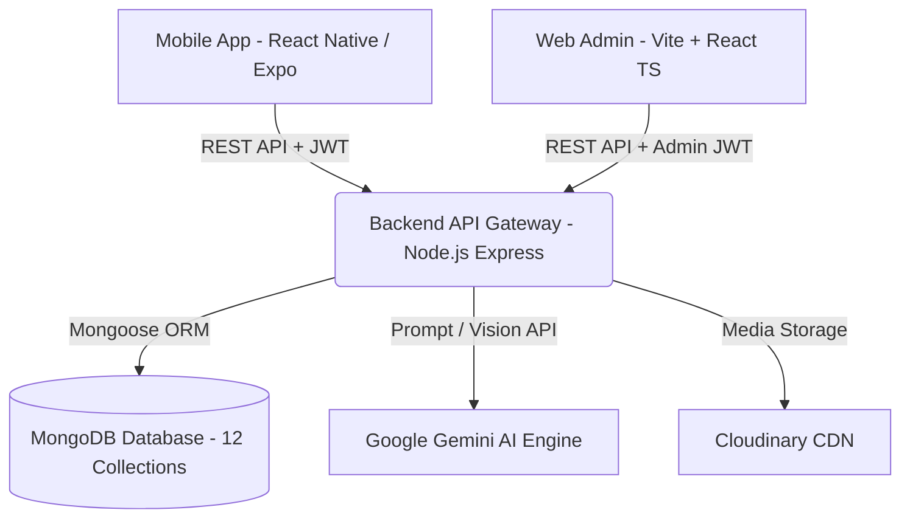
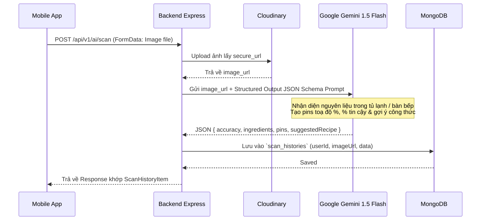

# Kế Hoạch Triển Khai Kiến Trúc Hệ Thống Backend & Web Admin - SmartCook Production Grade

> **Trạng thái:** Đã rà soát chuyên sâu 100% source code Frontend Mobile (`smartcook-mobile`), đối chiếu từng Interface, Service, Component và tài liệu SRS.
> **Mục tiêu:** Xây dựng hệ thống Backend chuẩn Production (`smartcook-backend`) và trang quản trị Web Admin Vite (`smartcook-web`) đáp ứng trọn vẹn mọi tính năng hiện tại của ứng dụng, đặc biệt là tính năng tích hợp AI và GPS.

---

## 1. Tổng Quan Hệ Sinh Thái Dự Án (Ecosystem Architecture)



- **Mobile Client (`smartcook-mobile`)**: React Native (Expo), TypeScript, Tailwind/NativeWind, Expo Router, Speech TTS tiếng Việt, Image Picker, Location GPS.
- **Backend Service (`smartcook-backend`)**: Node.js, Express.js, TypeScript, Mongoose ODM, MongoDB 7.0+, JWT Auth (Access + Refresh Token), Joi Validation, Cloudinary, Gemini AI SDK.
- **Web Admin Portal (`smartcook-web`)**: Vite + React, TypeScript, Tailwind CSS, TanStack Query, React Hook Form, Recharts.

---

## 2. Thiết Kế Cơ Sở Dữ Liệu Chi Tiết (12 MongoDB Schemas & Indexes)

Sau khi rà soát tỉ mỉ toàn bộ Frontend (`recipe.ts`, `preferenceService.ts`, `cartService.ts`, `cookingHistoryService.ts`, `scanHistoryService.ts`, `storeService.ts`, `FridgeView.tsx`, `cooking-mode.tsx`), hệ thống cần **12 Collections** được chuẩn hoá kiểu dữ liệu 1-1 với Mobile:

### 2.1. Nhóm Core & Người Dùng
#### 1. `users` Collection
Lưu trữ thông tin tài khoản, cấp bậc đầu bếp (XP), và khẩu vị cá nhân hoá.
- `_id`: `ObjectId`
- `email`: `String` (Unique, Trim, Lowercase, Indexed)
- `password`: `String` (Bcrypt hashed, `select: false` khi query thường)
- `firstName`: `String` (Từ màn Register)
- `lastName`: `String` (Từ màn Register)
- `fullName`: `String` (Virtual hoặc lưu trữ phục vụ hiển thị)
- `avatar`: `String` (URL Cloudinary)
- `role`: `String` (Enum: `['user', 'admin']`, Default: `'user'`)
- `chefExp`: `Number` (Kinh nghiệm XP tích luỹ từ việc nấu ăn, mặc định: 0, mỗi món hoàn thành +50 XP)
- `level`: `String` (Cấp bậc: "Tập sự", "Bếp gia đình", "Đầu bếp tài ba", "Bếp trưởng")
- `preferences`: `Object` (Khớp 100% với `UserPreferences` từ Onboarding Survey):
  - `hasCompletedSurvey`: `Boolean` (Default: false)
  - `portion`: `String` (Enum: `['1', '2', '3-4', '5+']`, Default: `'3-4'`)
  - `cuisines`: `[String]` (Vd: `['vietnamese', 'asian', 'healthy', 'western', 'quick', 'budget', 'vegetarian', 'dessert']`)
  - `healthGoal`: `String` (Enum: `['healthy', 'loss', 'muscle', 'budget']`, Default: `'healthy'`)
  - `restrictions`: `[String]` (Vd: `['no-spicy', 'peanut', 'seafood', 'lactose', 'vegetarian']`)
  - `tasteProfile`: `[String]` (Vd: `['dam-da', 'thanh-dam', 'cay-nong', 'ngot-thanh', 'chua-cay', 'beo-ngay']`)
  - `cookingTime`: `String` (Enum: `['quick', 'medium', 'standard', 'slow']`)
  - `updatedAt`: `Date`
- `favoriteRecipeIds`: `[{ type: ObjectId, ref: 'Recipe' }]`
- `refreshToken`: `String` (Lưu token hash hoặc whitelist để hỗ trợ Silent Refresh Token)
- `isActive`: `Boolean` (Default: true, Admin có thể khoá tài khoản)
- `createdAt`, `updatedAt`: `Date`
- **Indexes**: `{ email: 1 }` (Unique), `{ role: 1 }`

#### 2. `categories` Collection
Quản lý cây danh mục món ăn (dành cho Web Admin quản trị linh hoạt và Mobile filter).
- `_id`: `ObjectId`
- `name`: `String` (Vd: "Gia đình", "Nấu nhanh < 20p", "Healthy", "Tiết kiệm", "Trẻ em", "Ăn chay", "Món Việt", "Tráng miệng")
- `code`: `String` (Unique slug: `family`, `quick`, `healthy`, `budget`, `kids`, `vegetarian`, `vietnamese`, `dessert`)
- `color`: `String` (Mã màu HEX: `#FF6B35`, `#10B981`... đồng bộ Mobile `CATEGORIES`)
- `icon`: `String` (Tên icon Ionicons hoặc URL)
- `order`: `Number` (Thứ tự hiển thị trên thanh tabs)
- `isActive`: `Boolean` (Default: true)
- **Indexes**: `{ code: 1 }` (Unique), `{ order: 1 }`

---

### 2.2. Nhóm Nấu Ăn, Công Thức & Tủ Lạnh
#### 3. `ingredients` Collection (Thư viện nguyên liệu chuẩn)
Master Database gồm 14 nhóm nguyên liệu từ `FridgeView.tsx`.
- `_id`: `ObjectId`
- `name`: `String` (Vd: "Thịt gà", "Thịt thăn bò", "Cà chua bi", "Cá hồi phi lê", "Nước mắm")
- `normalizedName`: `String` (Tên không dấu viết thường để match nhanh: "thit ga", "thit than bo")
- `aliases`: `[String]` (Mảng từ đồng nghĩa khớp `KEYWORD_MAP` trên FE: `["ga", "dui ga", "uc ga", "canh ga"]`)
- `category`: `String` (Enum 14 nhóm: `meat`, `seafood`, `greens`, `veggies`, `herbs`, `fruits`, `egg_tofu`, `dairy`, `carbs`, `grain`, `seasoning`, `spice`, `sauces`, `dry`)
- `subCategory`: `String` (Vd: "Thịt gia cầm & heo", "Rau xanh các loại", "Dầu ăn & sốt nấu")
- `icon`: `String` (Icon name / MaterialCommunityIcons)
- `defaultUnit`: `String` (g, kg, ml, muỗng canh, quả, miếng)
- `averagePrice`: `Number` (Giá tham khảo vnđ để ước lượng giá tiền món ăn và giỏ hàng)
- **Indexes**: `{ normalizedName: 1 }`, `{ aliases: 1 }`, `{ category: 1 }`, Text Index trên `name` và `aliases`.

#### 4. `recipes` Collection (Trung tâm dữ liệu của ứng dụng)
Khớp 100% với Interface `Recipe` trong `recipe.ts` và `CreateRecipeModal.tsx`.
- `_id`: `ObjectId`
- `title`: `String` (Tên món ăn, vd: "Cơm Gà Teriyaki Áp Chảo")
- `author`: `String` (Tên tác giả hiển thị, vd: "Chef Gordon", "Minh Tuấn")
- `authorId`: `ObjectId` (Ref: `User`, null nếu là món hệ thống của Admin)
- `categoryCode`: `String` (Ref: `Category.code`, vd: "family", "healthy")
- `badge`: `String` (Tag nổi bật hiển thị trên thẻ card: "👨‍👩‍👧 Gia đình • 4 phần", "⭐ 4.9 • 30 phút")
- `sub`: `String` (Mô tả ngắn dòng phụ: "Đậm đà • Cả nhà thích")
- `description`: `String` (Mô tả chi tiết công thức)
- `image`: `String` (URL ảnh đại diện chất lượng cao)
- `minutes`: `Number` (Thời gian chế biến tổng cộng tính theo phút, vd: 25)
- `difficulty`: `String` (Enum: `['Dễ', 'Trung bình', 'Nâng cao']`)
- `servings`: `String` (Vd: "4 phần", "2 - 3 người")
- `servingsCount`: `Number` (Số khẩu phần chuẩn, phục vụ thuật toán Scaler co giãn nguyên liệu)
- `price`: `String` (Hiển thị ước tính: "~65.000đ")
- `costEstimation`: `Number` (Giá tiền số nguyên vnđ: 65000)
- `calories`: `Number` (Tổng calories mỗi khẩu phần, vd: 450)
- `rating`: `Number` (Trung bình sao đánh giá: 1.0 - 5.0, Default: 5.0)
- `reviewCount`: `Number` (Số lượng lượt đánh giá, Default: 0)
- `tags`: `[String]` (Tags tìm kiếm: `['hot', 'popular', 'new', 'dinner', 'chicken']`)
- `ingredients`: `[Object]` (Khớp `RecipeIngredient`):
  - `ingredientId`: `ObjectId` (Ref: `Ingredient`, optional)
  - `name`: `String` (Vd: "Thịt đùi gà phi lê")
  - `amount`: `String` (Vd: "400g", "2 muỗng canh", "1/2 củ")
  - `baseQuantity`: `Number` (Định lượng số cho 1 phần ăn để nhân tỷ lệ scaler)
  - `unit`: `String` (g, ml, quả, muỗng)
  - `icon`: `String` (Tên icon đại diện)
- `steps`: `[Object]` (Khớp `RecipeStep` - Chuyên dùng cho Cooking Mode):
  - `stepNumber`: `Number` (1, 2, 3...)
  - `title`: `String` (Tiêu đề bước: "Sơ chế gà", "Làm sốt Teriyaki")
  - `description`: `String` (Hướng dẫn chi tiết, được TTS giọng nói AI đọc)
  - `timerMinutes`: `Number` (Số phút hẹn giờ cho bước này, optional)
  - `tip`: `String` (Mẹo đầu bếp chuyên gia cho bước này)
- `nutrition`: `Object` (Khớp `RecipeNutrition`):
  - `calories`: `Number`
  - `protein`: `String` (Vd: "35g")
  - `carbs`: `String` (Vd: "45g")
  - `fat`: `String` (Vd: "14g")
  - `fiber`: `String` (Vd: "5g")
  - `sodium`: `String` (Vd: "680mg")
  - `advice`: `String` (Lời khuyên dinh dưỡng từ chuyên gia)
- `status`: `String` (Enum: `['published', 'pending_approval', 'draft']`, Default: `'published'`)
- `createdAt`, `updatedAt`: `Date`
- **Indexes**: 
  - Compound Index: `{ categoryCode: 1, difficulty: 1, calories: 1 }`
  - Text Index: `{ title: "text", description: "text", tags: "text" }`
  - `{ rating: -1 }`, `{ reviewCount: -1 }`, `{ status: 1 }`

#### 5. `user_fridges` Collection (Kho Tủ Lạnh Thông Minh Cá Nhân - MỚI RÀ SOÁT)
Lưu danh sách nguyên liệu người dùng đang có trong tủ lạnh (Từ tab `FridgeView.tsx`).
- `_id`: `ObjectId`
- `userId`: `ObjectId` (Ref: `User`, Indexed)
- `ingredientName`: `String` (Tên nguyên liệu, vd: "Thịt gà", "Nước tương", "Mật ong")
- `normalizedName`: `String` (Chuẩn hoá không dấu: "thit ga", "nuoc tuong")
- `category`: `String` (Nhóm: meat, veggies, sauces...)
- `quantity`: `String` (Optional, vd: "500g", "2 hộp")
- `addedAt`: `Date` (Default: Date.now)
- `isCustom`: `Boolean` (Người dùng gõ tay thêm vào hay chọn từ danh mục chuẩn)
- **Indexes**: `{ userId: 1, normalizedName: 1 }` (Unique tránh trùng)

---

### 2.3. Nhóm AI & Tương Tác Trải Nghiệm
#### 6. `scan_histories` Collection (Lịch Sử Quét AI Camera / Tủ Lạnh)
Khớp 100% cấu trúc `ScanHistoryItem` từ `scanHistoryService.ts` & `ScanAIView.tsx`.
- `_id`: `ObjectId`
- `userId`: `ObjectId` (Ref: `User`, Indexed)
- `title`: `String` (Vd: "Bàn bếp chuẩn bị trưa nay", "Ngăn mát tủ lạnh sáng nay")
- `imageUrl`: `String` (URL ảnh chụp/tải lên từ Cloudinary)
- `scannedAt`: `Date` (Thời gian quét)
- `accuracy`: `Number` (Độ chính xác nhận diện tổng quan: 90 - 99%)
- `ingredients`: `[Object]` (Khớp `ScanDetectedIngredient`):
  - `name`: `String` (Vd: "Thịt ức gà", "Cà chua bi", "Quả bơ sáp")
  - `confidence`: `String` (Vd: "98%", "96%")
  - `icon`: `String` (Icon hiển thị: "food-drumstick", "fruit-cherries")
- `pins`: `[Object]` (Khớp `ScanPin` - Toạ độ ghim nhãn nhận diện trên ảnh):
  - `text`: `String` (Vd: "🍗 Ức gà (98%)")
  - `top`: `Number` (Toạ độ %)
  - `bottom`: `Number` (Toạ độ %)
  - `left`: `Number` (Toạ độ %)
  - `right`: `Number` (Toạ độ %)
- `suggestedRecipe`: `Object` (Khớp `ScanSuggestedRecipe` - Món ăn AI gợi ý tối ưu):
  - `recipeId`: `ObjectId` (Ref: `Recipe`, optional)
  - `title`: `String` (Vd: "Salad Ức Gà Bơ Sáp Sốt Chanh Leo")
  - `desc`: `String` (Lý do gợi ý từ 100% nguyên liệu quét được)
  - `calories`: `Number`
  - `durationMinutes`: `Number`
  - `matchPercent`: `Number` (Vd: 95%, 100%)
- **Indexes**: `{ userId: 1, scannedAt: -1 }`

#### 7. `cooking_histories` Collection (Nhật Ký Nấu Ăn & XP Gamification)
Khớp 100% cấu trúc `CookingHistoryItem` từ `cookingHistoryService.ts` & `cooking-mode.tsx`.
- `_id`: `ObjectId`
- `userId`: `ObjectId` (Ref: `User`, Indexed)
- `recipeId`: `ObjectId` (Ref: `Recipe`, Indexed)
- `recipeName`: `String` (Tên món ăn đã nấu)
- `image`: `String` (URL ảnh món ăn)
- `cookedAt`: `Date` (Thời gian hoàn thành)
- `durationMinutes`: `Number` (Thời gian người dùng nấu thực tế, vd: 25)
- `servings`: `Number` (Số phần đã nấu, vd: 3)
- `usedIngredients`: `[String]` (Danh sách nguyên liệu đã tích chọn sử dụng)
- `calories`: `Number` (Lượng calo đã nạp)
- `rating`: `Number` (Số sao đánh giá nhanh sau khi nấu: 1 - 5)
- `xpEarned`: `Number` (Điểm kinh nghiệm nhận được, vd: 50)
- `completedPhotoUrl`: `String` (Ảnh chụp thành phẩm người dùng chụp chia sẻ)
- **Indexes**: `{ userId: 1, cookedAt: -1 }`

#### 8. `reviews` Collection (Đánh Giá & Nhận Xét Món Ăn)
- `_id`: `ObjectId`
- `recipeId`: `ObjectId` (Ref: `Recipe`, Indexed)
- `userId`: `ObjectId` (Ref: `User`)
- `rating`: `Number` (1 - 5 sao, bắt buộc)
- `comment`: `String` (Nội dung nhận xét)
- `images`: `[String]` (Ảnh feedback món ăn của người dùng)
- `likesCount`: `Number` (Default: 0)
- `createdAt`: `Date`
- **Indexes**: `{ recipeId: 1, createdAt: -1 }`, `{ userId: 1 }`

---

### 2.4. Nhóm Kế Hoạch, Giỏ Hàng & Định Vị Siêu Thị
#### 9. `meal_plans` Collection (Lập Kế Hoạch Bữa Ăn Theo Tuần)
Khớp cấu trúc lịch ăn 7 ngày từ `PlannerView.tsx`.
- `_id`: `ObjectId`
- `userId`: `ObjectId` (Ref: `User`, Indexed)
- `weekStartDate`: `Date` (Ngày đầu tuần - Thứ 2)
- `days`: `[Object]` (7 ngày: Thứ 2 -> Chủ Nhật):
  - `dayOfWeek`: `String` (Vd: "Thứ 2", "Thứ 3"...)
  - `date`: `String` (Vd: "2026-09-17")
  - `meals`: `[Object]`:
    - `slot`: `String` (Enum: `['Bữa Sáng', 'Bữa Trưa', 'Bữa Tối', 'Bữa Phụ']`)
    - `time`: `String` (Vd: "07:00", "12:00", "19:00")
    - `recipeId`: `ObjectId` (Ref: `Recipe`)
    - `calories`: `Number`
    - `isCooked`: `Boolean` (Default: false)
- **Indexes**: `{ userId: 1, weekStartDate: 1 }` (Unique per user/week)

#### 10. `cart_items` Collection (Danh Sách Mua Sắm & Đi Chợ)
Khớp 100% cấu trúc `CartItem` từ `cartService.ts` và danh sách đi chợ trong `PlannerView.tsx`.
- `_id`: `ObjectId`
- `userId`: `ObjectId` (Ref: `User`, Indexed)
- `name`: `String` (Tên nguyên liệu cần mua, vd: "Thịt thăn bò Tenderloin")
- `amount`: `String` (Định lượng: "500g", "1 vỉ")
- `price`: `Number` (Giá dự kiến: 85000)
- `recipeTitle`: `String` (Ghi chú mua cho món ăn nào, vd: "Bò Bít Tết Sốt Tiêu")
- `recipeId`: `ObjectId` (Ref: `Recipe`, optional)
- `bought`: `Boolean` (Đã mua hay chưa, Default: false)
- `category`: `String` (Vd: "Thịt & Cá", "Rau củ", "Bơ & Gia vị")
- `addedAt`: `Date` (Default: Date.now)
- **Indexes**: `{ userId: 1, bought: 1 }`

#### 11. `stores` Collection (Chuỗi Siêu Thị & Cửa Hàng Tiện Lợi - GeoSpatial)
Khớp 100% cấu trúc `Store` từ `mockStores.ts` & `storeService.ts`. Thay thế hardcode trên FE bằng Geo Query MongoDB.
- `_id`: `ObjectId`
- `name`: `String` (Vd: "WinMart+ Nguyễn Thị Minh Khai", "Co.opmart Cống Quỳnh")
- `brand`: `String` (WinMart, Co.opmart, Tops Market, Bách Hóa Xanh, Emart, Lotte Mart, Big C...)
- `address`: `String` (Vd: "123 Nguyễn Thị Minh Khai, P. Bến Thành, Quận 1, TP.HCM")
- `openHours`: `String` (Vd: "06:00 - 22:00")
- `phone`: `String` (Vd: "028 7108 1368")
- `logo`: `String` (URL logo chuỗi siêu thị)
- `location`: `Object` (GeoJSON Point bắt buộc cho MongoDB 2dsphere):
  - `type`: `String` (Luôn là `"Point"`)
  - `coordinates`: `[Number]` (`[longitude, latitude]` chuẩn GeoJSON - vd: `[106.6909, 10.7769]`)
- `isActive`: `Boolean` (Default: true)
- **Indexes**: **`{ location: "2dsphere" }`** (Chỉ mục không gian địa lý phục vụ toán tử `$near` / `$geoNear` tính khoảng cách tức thì theo mét/km)

#### 12. `notifications` Collection (Thông Báo Ứng Dụng)
- `_id`: `ObjectId`
- `userId`: `ObjectId` (Ref: `User`, Indexed)
- `title`: `String` (Vd: "Đến giờ chuẩn bị bữa tối!", "Nhắc nhở đi chợ")
- `body`: `String` (Nội dung thông báo)
- `type`: `String` (Enum: `['meal_reminder', 'cooking_timer', 'shopping_reminder', 'system']`)
- `data`: `Object` (Chứa `recipeId` hoặc link điều hướng sâu)
- `isRead`: `Boolean` (Default: false)
- `createdAt`: `Date` (TTL Index tự xoá sau 30 ngày)
- **Indexes**: `{ userId: 1, isRead: 1 }`, `{ createdAt: 1 }` (ExpireAfterSeconds: 2592000)

---

## 3. Kiến Trúc Tích Hợp Trí Tuệ Nhân Tạo (AI Engine Integration)

Người dùng đặc biệt yêu cầu tích hợp AI. SmartCook sẽ tích hợp **Google Gemini 1.5 Flash API** (tối ưu chi phí, độ trễ cực thấp < 1.5s và khả năng Multimodal Vision xuất sắc):



### Các Luồng AI Được Thiết Kế Chuyên Biệt:
1. **AI Fridge & Tabletop Vision Scanner (`/api/v1/ai/scan`)**:
   - Nhận ảnh từ Camera hoặc Thư viện ảnh của người dùng.
   - Sử dụng Gemini Vision với `responseSchema` ép kiểu JSON trả về: danh sách nguyên liệu (`name`, `confidence`), toạ độ ghim nhãn (`pins: {text, top, left, right, bottom}`), và món ăn sáng tạo tối ưu nhất không cần mua thêm (`suggestedRecipe`).
2. **AI Smart Recipe Generator (`/api/v1/ai/generate-recipe`)**:
   - Người dùng tick chọn những gì còn lại trong tủ lạnh (`FridgeView`).
   - AI sinh công thức món ăn mới theo khẩu vị (`tasteProfile`), mục tiêu (`healthGoal`), và thời gian nấu (`cookingTime`).
3. **AI Nutrition Advisor (`/api/v1/ai/analyze-nutrition`)**:
   - Tự động bóc tách và phân tích Calo, Protein, Carbs, Fat từ danh sách nguyên liệu công thức mới người dùng nhập vào.

---

## 4. Kiến Trúc Backend Node.js & Cấu Trúc Mã Nguồn (N-Tier Architecture)

Backend sẽ tuân thủ nghiêm ngặt mô hình nhiều tầng để đảm bảo tính module hoá, dễ test và scale:

```text
smartcook-backend/
├── src/
│   ├── config/             # DB Connection (MongoDB), Cloudinary, Gemini AI client, JWT config
│   ├── constants/          # HTTP Status, Error Codes, Regex, Default Preferences
│   ├── models/             # 12 Mongoose Schemas & TypeScript Interfaces
│   │   ├── User.ts
│   │   ├── Category.ts
│   │   ├── Ingredient.ts
│   │   ├── Recipe.ts
│   │   ├── UserFridge.ts
│   │   ├── ScanHistory.ts
│   │   ├── CookingHistory.ts
│   │   ├── Review.ts
│   │   ├── MealPlan.ts
│   │   ├── CartItem.ts
│   │   ├── Store.ts
│   │   └── Notification.ts
│   ├── repositories/       # Tầng tương tác CSDL trực tiếp (Tách biệt khỏi logic nghiệp vụ)
│   ├── services/           # Business Logic:
│   │   ├── auth.service.ts
│   │   ├── user.service.ts
│   │   ├── recipe.service.ts
│   │   ├── fridge.service.ts     # Thuật toán tính % khớp tủ lạnh (Fridge Match Ranking)
│   │   ├── ai.service.ts         # Gemini Multimodal API calls & Prompting
│   │   ├── planner.service.ts
│   │   ├── cart.service.ts
│   │   └── store.service.ts      # GeoSpatial queries ($geoNear)
│   ├── controllers/        # Điều hướng Request/Response
│   ├── routes/             # API Endpoints (/api/v1/...)
│   ├── middlewares/        # AuthGuard (JWT), RoleGuard (Admin), Validation (Joi/Zod), ErrorHandler, RateLimiter
│   ├── utils/              # Helper: Token generation, Password hashing, Logger (Winston/Morgan)
│   └── app.ts / server.ts  # Khởi chạy Express Server
├── .env.example
├── tsconfig.json
└── package.json
```

---

## 5. Thiết Kế Dự Án Quản Trị Web Admin (`smartcook-web`)

Sử dụng **Vite + React + TypeScript + Tailwind CSS** kết nối chung REST API Backend:
- **Trang Đăng Nhập Quản Trị**: Dành riêng cho tài khoản có `role: 'admin'`.
- **Trang Tổng Quan (Dashboard)**: Biểu đồ số lượng công thức, người dùng mới, thống kê lượt quét AI, các món được nấu nhiều nhất trong tuần.
- **Quản Lý Công Thức (Recipe Management)**:
  - Bảng danh sách công thức (Phân trang, tìm kiếm, lọc theo danh mục, độ khó, trạng thái).
  - Modal/Form thêm mới công thức chuẩn chuyên nghiệp (Tải ảnh món lên Cloudinary, thêm nhiều bước nấu có hẹn giờ, phân tích dinh dưỡng).
- **Quản Lý Nguyên Liệu & Danh Mục (Ingredients & Categories)**:
  - Quản trị 14 nhóm nguyên liệu tủ lạnh, thêm từ đồng nghĩa (aliases) để tối ưu thuật toán tìm kiếm của AI.
- **Quản Lý Siêu Thị (Store Management)**:
  - Bản đồ / Danh sách siêu thị, nhập toạ độ GPS (Latitude, Longitude) để Mobile tìm kiếm lân cận.
- **Quản Lý Người Dùng & Nhật Ký Hệ Thống**:
  - Xem danh sách thành viên, cấp bậc đầu bếp XP, phân bổ khẩu vị người dùng.

---

## 6. Lộ Trình Triển Khai Chi Tiết (Implementation Phases)

### Giai đoạn 1: Khởi Tạo Cấu Trúc Backend & Base Authentication
- Cài đặt các thư viện cần thiết: `mongoose`, `jsonwebtoken`, `bcryptjs`, `cors`, `helmet`, `joi`, `dotenv`, `@google/genai` (hoặc `@google/generative-ai`), `multer`, `cloudinary`.
- Thiết lập chuẩn TypeScript, kết nối MongoDB an toàn, cấu hình biến môi trường `.env`.
- Triển khai Bộ xử lý lỗi toàn cục (`GlobalErrorHandler`) và chuẩn hoá định dạng phản hồi API (`ApiResponse`).
- Xây dựng Module Auth: Đăng ký, Đăng nhập, Refresh Token, Cập nhật khảo sát khẩu vị Onboarding.

### Giai đoạn 2: Quản Lý Nguyên Liệu, Tủ Lạnh & Công Thức Món Ăn
- Xây dựng Schemas & Repositories cho `categories`, `ingredients`, `recipes`, `user_fridges`.
- Viết API CRUD Món ăn cho Web Admin (hỗ trợ upload ảnh Cloudinary).
- Viết API lấy danh sách công thức cho Mobile (Search, Filter đa tiêu chí, Phân trang 10 món/trang).
- Triển khai thuật toán tính `% khớp tủ lạnh` (`fridgeMatchPercent`) trên Backend dựa trên danh sách nguyên liệu trong tủ lạnh của người dùng.

### Giai đoạn 3: Tích Hợp AI Engine & GeoSpatial Siêu Thị
- Xây dựng Service tích hợp Gemini 1.5 Flash Vision.
- Endpoint `/api/v1/ai/scan`: Tiếp nhận ảnh -> Phân tích -> Trả về danh sách nguyên liệu, toạ độ pins, món ăn đề xuất -> Lưu `scan_histories`.
- Cấu hình chỉ mục `2dsphere` cho `stores`. Viết Endpoint `/api/v1/stores/nearby` nhận toạ độ `latitude, longitude` từ Mobile và trả về siêu thị gần nhất kèm khoảng cách km.

### Giai đoạn 4: Kế Hoạch Bữa Ăn, Giỏ Hàng & Gamification Nấu Ăn
- Hoàn thiện API `meal_plans` (lịch ăn tuần 7 ngày) và `cart_items` (danh sách đi chợ).
- Hoàn thiện API `cooking_histories` (ghi nhận thời gian nấu, cộng 50 XP cho người dùng, lưu ảnh thành phẩm).
- Hoàn thiện API `reviews` (bình luận, đánh giá sao).

### Giai đoạn 5: Khởi Tạo & Phát Triển Web Admin (`smartcook-web`)
- Khởi tạo repo `smartcook-web` bằng Vite + React + TypeScript + Tailwind CSS.
- Xây dựng UI Dashboard, Quản lý công thức, Quản lý siêu thị, Quản lý danh mục.
- Kết nối API Backend và kiểm thử toàn diện End-to-End.

---

## 7. Kế Hoạch Xác Minh & Kiểm Thử (Verification Plan)

### Kiểm Thử Tự Động (Automated Testing)
- Chạy unit tests cho các thuật toán cốt lõi:
  - Thuật toán chuẩn hoá tiếng Việt không dấu (`normalizeText`).
  - Thuật toán tính độ khớp nguyên liệu tủ lạnh (`matchIngredient` & `fridgeMatchPercent`).
- Kiểm tra tính hợp lệ của GeoJSON query trên collection `stores`.

### Kiểm Thử Tích Hợp (API & Integration Verification)
- Sử dụng Postman / Thunder Client để kiểm thử toàn bộ luồng:
  1. Auth Flow: `register` -> `login` -> `onboarding-survey` -> `refresh-token`.
  2. Fridge & Recipe Flow: thêm nguyên liệu vào `user_fridges` -> gọi API recipes kiểm tra xem `fridgeMatchPercent` có tính toán chuẩn xác không.
  3. AI Scan Flow: Gửi ảnh mẫu bàn bếp -> Gemini phân tích -> Kiểm tra cấu trúc JSON trả về có đủ `pins` và `suggestedRecipe`.
  4. Nearby Stores Flow: Gửi toạ độ Quận 1 (10.7725, 106.698) -> Kiểm tra danh sách siêu thị trả về có sắp xếp đúng khoảng cách tăng dần.
