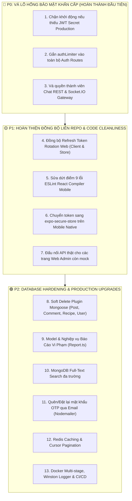

# Kế Hoạch Nâng Cấp Toàn Diện Hệ Thống Chuẩn Production - SmartCook Ecosystem

> **Tài liệu:** `smartcook-backend/PRODUCTION_IMPLEMENTATION_PLAN.md`  
> **Mục tiêu:** Nâng cấp toàn diện hệ thống Backend (`smartcook-backend`), Cơ sở dữ liệu (MongoDB Atlas), đồng thời chuẩn hoá kết nối liên repo với Frontend (`smartcook-web`) và Mobile (`smartcook-mobile`) từ mức hoàn thiện 80%–85% lên chuẩn vận hành doanh nghiệp 100% (Enterprise Production-Ready).  
> **Nguyên tắc triển khai:** Thực hiện theo thứ tự ưu tiên (P0 ➔ P1 ➔ P2), viết Unit/E2E test kiểm thử 100%, commit atomic rõ ràng, kiểm tra bảo mật OWASP trước khi release.

---

## 📊 1. Đánh Giá Hiện Trạng Toàn Hệ Sinh Thái (Current Status: ~80% - 85%)

| Phân hệ | Mức hoàn thiện | Trạng thái kỹ thuật & Điểm mạnh | Vấn đề tồn đọng cần giải quyết |
| :--- | :---: | :--- | :--- |
| **Backend** (`smartcook-backend`) | **85%** | • `npm run build` (tsc) thành công 100%.<br>• Kiến trúc Controller - Service - Repository - Model chuẩn.<br>• Pass 8 Phase E2E tests nghiệp vụ chính. | • **P0 Security:** JWT Secret còn fallback default ở production.<br>• **P0 Security:** Chưa gắn `authLimiter` vào auth routes.<br>• **P0 Security:** Socket.IO & Chat REST chưa kiểm tra membership người gửi/đọc.<br>• Xoá cứng dữ liệu (thiếu Soft Delete).<br>• Thiếu script `npm run lint`. |
| **Web Portal** (`smartcook-web`) | **85%** | • `npm run build` (tsc -b && vite build) tối ưu bundle chunks tốt.<br>• React 19 + Vite 8 + TailwindCSS 4 + Zustand + TanStack Query hiện đại.<br>• UI Dashboard & Community phong phú. | • **P1 Sync:** Refresh-token rotation lệch giữa `localStorage` và `useAuthStore`.<br>• Một số trang quản trị (AI Engine, Moderation, Settings) còn fallback mock.<br>• Component Admin quản lý quá lớn (~1.500 dòng). |
| **Mobile App** (`smartcook-mobile`) | **80%** | • `tsc --noEmit` thành công 100%.<br>• Đã tích hợp trọn bộ luồng AI, tủ lạnh, công thức, đi chợ GPS, chat. | • **P1 Linter:** 9 errors và 75 warnings (`react-hooks/set-state-in-effect`, impure `Date.now()`).<br>• **P1 Security:** Lưu token bằng `AsyncStorage` chưa chuẩn OWASP (cần `expo-secure-store`).<br>• `PlannerView` chưa kết nối luồng điều hướng chính. |

---

## 🎯 2. Ma Trận Phân Kỳ & Mức Độ Ưu Tiên (Priority Implementation Matrix)



---

## 🔴 GIAI ĐOẠN 0: VÁ LỖ HỔNG BẢO MẬT CỐT LÕI (P0 CRITICAL SECURITY)

### 0.1. Chặn Khởi Động Nếu Thiếu JWT Secret Khi Chạy Production
- **Vị trí:** [smartcook-backend/src/config/env.ts](file:///e:/FPTU/Term07/project/smartcook-backend/src/config/env.ts)
- **Vấn đề:** Khi `NODE_ENV=production`, nếu biến môi trường `JWT_SECRET` hoặc `JWT_REFRESH_SECRET` bị thiếu hoặc bằng giá trị default `smartcook_default_jwt_secret_change_in_production`, server vẫn tiếp tục chạy. Kẻ tấn công có thể giả mạo token Admin.
- **Giải pháp:**
  - Thêm validation logic chặt chẽ trong `getEnv()`:
    ```typescript
    if (NODE_ENV === "production") {
      const isDefaultSecret = (secret: string) => !secret || secret.includes("smartcook_default") || secret.includes("change_in_production");
      if (isDefaultSecret(process.env.JWT_SECRET || "") || isDefaultSecret(process.env.JWT_REFRESH_SECRET || "")) {
        throw new Error("🚨 FATAL SECURITY: JWT_SECRET và JWT_REFRESH_SECRET hợp lệ là BẮT BUỘC khi chạy ở chế độ production!");
      }
    }
    ```

### 0.2. Kích Hoạt `authLimiter` Chống Brute-Force Cho Toàn Bộ Auth Endpoints
- **Vị trí:** [smartcook-backend/src/routes/auth.route.ts](file:///e:/FPTU/Term07/project/smartcook-backend/src/routes/auth.route.ts)
- **Vấn đề:** `authLimiter` đã được định nghĩa trong `src/middlewares/rateLimit.ts` nhưng chưa được áp dụng vào router.
- **Giải pháp:**
  - Gắn middleware `authLimiter` vào tất cả các route xác thực công khai:
    - `router.post("/register", authLimiter, validate(registerSchema), authController.register);`
    - `router.post("/login", authLimiter, validate(loginSchema), authController.login);`
    - `router.post("/google", authLimiter, validate(googleAuthSchema), authController.googleLogin);`
    - `router.post("/refresh-token", authLimiter, validate(refreshTokenSchema), authController.refreshToken);`
    - `router.post("/forgot-password", authLimiter, ...);` (khi triển khai Phase 2)

### 0.3. Thắt Chặt Phân Quyền Truy Cập Chat & Socket.IO Gateway
- **Vị trí:** 
  - [smartcook-backend/src/services/chat.service.ts](file:///e:/FPTU/Term07/project/smartcook-backend/src/services/chat.service.ts)
  - [smartcook-backend/src/socket/chat.gateway.ts](file:///e:/FPTU/Term07/project/smartcook-backend/src/socket/chat.gateway.ts)
- **Vấn đề:** 
  - `ChatService.getMessages()` và `ChatService.sendMessage()` không kiểm tra người gọi có nằm trong `conversation.participants` (đối với hội thoại 1-1) hay không.
  - Socket.IO gateway cho phép bất kỳ socket nào gọi `join_room`, `send_message`, `typing` chỉ cần biết `conversationId`.
- **Giải pháp:**
  - Tạo helper kiểm tra quyền: `validateConversationAccess(conversationId, userId)`.
  - Nếu là cuộc trò chuyện 1-1 (có `participants`): Kiểm tra `userId` có nằm trong danh sách hay không. Nếu không -> Ném lỗi `ForbiddenError("Bạn không có quyền truy cập cuộc trò chuyện này")`.
  - Cập nhật Socket.IO Gateway kiểm tra quyền trước khi cho socket `join(`conv_${conversationId}`)` và broadcast `new_message`.

---

## 🟡 GIAI ĐOẠN 1: ĐỒNG BỘ LIÊN REPO & CHUẨN HOÁ FRONTEND / MOBILE (P1)

### 1.1. Đồng Bộ Nguyên Tử Refresh-Token Rotation Trên Web
- **Vị trí:**
  - [smartcook-web/src/api/client.ts](file:///e:/FPTU/Term07/project/smartcook-web/src/api/client.ts)
  - [smartcook-web/src/store/useAuthStore.ts](file:///e:/FPTU/Term07/project/smartcook-web/src/store/useAuthStore.ts)
- **Vấn đề:** Interceptor của Axios chỉ ghi `newRefreshToken` vào `localStorage` mà không cập nhật state của `useAuthStore`. Khi hàm khác đọc `useAuthStore.getState().refreshToken`, nó nhận token cũ -> Bị reject và logout ngoài ý muốn.
- **Giải pháp:**
  - Bổ sung action `setTokens: (accessToken: string, refreshToken?: string) => void` trong `useAuthStore`.
  - Cập nhật cả `accessToken` và `refreshToken` vào cả Store và `localStorage` trong một lệnh gọi duy nhất.

### 1.2. Sửa Dứt Điểm 9 Lỗi ESLint & React Compiler Trên Mobile
- **Vị trí:**
  - `smartcook-mobile/src/components/NotificationModal.tsx`
  - `smartcook-mobile/src/components/GiftRewardsModal.tsx`
- **Vấn đề:** 
  - Gọi `setState()` đồng bộ trong `useEffect` gây re-render cascading lặp vô tận.
  - Gọi `Date.now()` trực tiếp trong thân component (impure render).
- **Giải pháp:**
  - Tách state khởi tạo hoặc wrap logic sync vào `useCallback` / event handlers thay vì kích hoạt bừa bãi trong `useEffect`.
  - Chuyển `Date.now()` vào helper hoặc `useMemo(() => Date.now(), [])`.

### 1.3. Áp Dụng `expo-secure-store` Cho Mobile Native (OWASP MASVS)
- **Vị trí:** `smartcook-mobile/src/services/apiClient.ts` và `authStorage.ts`
- **Giải pháp:**
  - Viết storage adapter: Trên iOS/Android dùng `expo-secure-store` để mã hoá token bằng phần cứng (Keychain / Android Keystore).
  - Tự động fallback sang `AsyncStorage` hoặc `localStorage` khi chạy trên nền tảng Web (`Platform.OS === 'web'`).

### 1.4. Đấu Nối Toàn Bộ API Thật Cho Web Admin & Tích Hợp Planner Mobile
- **Vị trí Web:**
  - [smartcook-web/src/pages/admin/AIEnginePage.tsx](file:///e:/FPTU/Term07/project/smartcook-web/src/pages/admin/AIEnginePage.tsx)
  - [smartcook-web/src/pages/admin/CommunityModerationPage.tsx](file:///e:/FPTU/Term07/project/smartcook-web/src/pages/admin/CommunityModerationPage.tsx)
  - `smartcook-web/src/pages/admin/SystemSettingsPage.tsx`
- **Giải pháp:**
  - Đấu nối vào backend API thật, loại bỏ dữ liệu mock khi đã kết nối online.
  - Phía Mobile: Gắn `PlannerView` trực tiếp vào Tab Bar hoặc Floating Action Menu chính của ứng dụng.

---

## 🟢 GIAI ĐOẠN 2: TỐI ƯU CƠ SỞ DỮ LIỆU & SCHEMA (DATABASE HARDENING)

### 2.1. Cơ Chế Xoá Mềm (Soft Delete Architecture)
- **Mục tiêu:** Không làm mất dữ liệu khi người dùng vô tình xoá hoặc phục vụ lưu vết kiểm toán (Audit).
- **Giải pháp:**
  - Tạo Mongoose plugin `src/models/plugins/softDeletePlugin.ts`:
    ```typescript
    export interface ISoftDeleteDocument {
      isDeleted: boolean;
      deletedAt?: Date | null;
      deletedBy?: mongoose.Types.ObjectId | null;
      restore(): Promise<this>;
      softDelete(deletedBy?: mongoose.Types.ObjectId): Promise<this>;
    }
    ```
  - Áp dụng vào: `Post.ts`, `Comment.ts`, `Recipe.ts`, `User.ts`.
  - Tự động lọc `{ isDeleted: { $ne: true } }` trên `find`, `findOne`, `countDocuments`.
  - Cung cấp method `restore(id)` cho Admin.

### 2.2. Collection Báo Cáo Vi Phạm (`Report.ts`)
- **Tạo Model:** `src/models/Report.ts`
  - `reporterId`: ObjectId (ref: User)
  - `targetType`: Enum `['post', 'comment', 'recipe', 'user']`
  - `targetId`: ObjectId
  - `reason`: Enum `['spam', 'inappropriate', 'harassment', 'misleading', 'other']`
  - `description`: String
  - `status`: Enum `['pending', 'reviewed', 'dismissed', 'action_taken']` (Default: `'pending'`)
  - `resolvedBy`: ObjectId (ref: User)
  - `resolutionNotes`: String
- **Endpoints:**
  - `POST /api/v1/reports`: Người dùng báo cáo bài/bình luận vi phạm.
  - `GET /api/v1/admin/reports`: Admin xem danh sách (phân trang, lọc theo trạng thái).
  - `PATCH /api/v1/admin/reports/:id`: Admin duyệt xử lý (tự động ẩn bài viết hoặc khoá tài khoản).

### 2.3. MongoDB Full-Text Search Index Đa Trường
- **Model `Recipe.ts`:**
  ```typescript
  RecipeSchema.index(
    { title: "text", description: "text", tags: "text" },
    { weights: { title: 10, tags: 5, description: 1 }, default_language: "none" }
  );
  ```
- **Model `Post.ts`:**
  ```typescript
  PostSchema.index(
    { dishName: "text", caption: "text", tags: "text" },
    { weights: { dishName: 8, caption: 4, tags: 2 }, default_language: "none" }
  );
  ```
- **Tối ưu truy vấn:** Thay thế toán tử `$regex` trong `recipe.repository.ts` bằng `$text: { $search: query }` kết hợp sắp xếp độ liên quan text score.

### 2.4. Dọn Dẹp Ảnh Mồ Côi Trên Cloudinary (Media Cleanup)
- **Vị trí:** `src/config/cloudinary.ts`
- **Giải pháp:**
  - Viết helper `deleteFromCloudinary(publicId: string): Promise<boolean>`.
  - Tự động kích hoạt xoá ảnh nền bất đồng bộ khi:
    - Xoá bài viết (`Post`): Duyệt toàn bộ `images[].publicId`.
    - User cập nhật Avatar mới: Xoá avatar cũ nếu lưu trên Cloudinary.

---

## 🛡️ GIAI ĐOẠN 3: NÂNG CẤP XÁC THỰC & BẢO MẬT TOÀN DIỆN

### 3.1. Quên & Đặt Lại Mật Khẩu Qua Email OTP
- **Quy trình chuẩn 3 bước:**
  1. `POST /api/v1/auth/forgot-password`: Nhập email -> Tạo mã OTP 6 chữ số ngẫu nhiên (mã hoá lưu với TTL 15 phút) -> Gửi email HTML qua `nodemailer`.
  2. `POST /api/v1/auth/verify-otp`: Kiểm tra mã OTP hợp lệ.
  3. `POST /api/v1/auth/reset-password`: Nhập mật khẩu mới -> Hash bcrypt 12 salt rounds -> Thu hồi toàn bộ refreshToken cũ để bảo mật session.

### 3.2. Chống NoSQL Injection & HTTP Parameter Pollution (HPP)
- Cài đặt `express-mongo-sanitize` và `hpp`:
  - Lọc sạch các key bắt đầu bằng `$` hoặc `.` trong `req.body`, `req.query`, `req.params`.
  - Ngăn ngừa truyền lặp param như `?id=1&id=2` gây crash ứng dụng.

---

## ⚡ GIAI ĐOẠN 4: HIỆU NĂNG, REDIS CACHING & SCALABILITY

### 4.1. Tầng Cache Dữ Liệu Với Redis
- **Endpoints đọc nhiều ít thay đổi:**
  - `GET /api/v1/categories`: Cache 24 giờ.
  - `GET /api/v1/ingredients`: Cache 12 giờ.
  - `GET /api/v1/stores`: Cache 6 giờ.
  - `GET /api/v1/recipes/trending`: Cache 30 phút.
- **Cache Invalidation:** Tự động xoá key khi Admin thêm/sửa/xoá danh mục hoặc nguyên liệu.

### 4.2. Phân Trang Con Trỏ (Cursor-Based Pagination) Cho Community Feed
- Sử dụng `query._id = { $lt: new Types.ObjectId(lastPostId) }` thay thế `skip(page * limit)`, đảm bảo tốc độ phản hồi < 10ms trên tập dữ liệu hàng trăm nghìn bài viết.

---

## 🚀 GIAI ĐOẠN 5: DEVOPS, OBSERVALITY & KIỂM THỬ TỰ ĐỘNG

### 5.1. Multi-Stage Dockerfile & Production Compose
- Image nhẹ chạy trên `node:20-alpine`, phân quyền user không đặc quyền (`USER node`).
- File `docker-compose.prod.yml` gồm các container: `backend`, `web` (Nginx static bundle), `redis`.

### 5.2. Structured Logging Với Winston
- Thay thế `console.log` bằng Winston Logger: Phân cấp `error`, `warn`, `info`, `http`. Tự động xoay file log theo ngày (`winston-daily-rotate-file`).

### 5.3. Bộ Script & CI/CD Pipeline
- Bổ sung vào [smartcook-backend/package.json](file:///e:/FPTU/Term07/project/smartcook-backend/package.json):
  ```json
  "lint": "tsc --noEmit",
  "test:e2e:all": "tsx src/scripts/runAllE2ETests.ts"
  ```
- Workflow `.github/workflows/ci.yml` kiểm tra tự động trước mỗi Pull Request.

---

## 📋 Lộ Trình Triển Khai Chi Tiết Từng Bước (Implementation Steps)

| Bước | Hạng mục | Repositories | Kiểm thử nghiệm thu (DoD) |
| :---: | :--- | :--- | :--- |
| **B1** | Vá bảo mật P0: JWT validation, `authLimiter`, Chat membership | `smartcook-backend` | Khởi động lỗi nếu thiếu secret; spam auth bị block; không thể đọc trộm tin nhắn phòng khác. |
| **B2** | Đồng bộ Refresh Token Web & Fix 9 lỗi ESLint Mobile | `smartcook-web`, `smartcook-mobile` | Web refresh token mượt mà không văng session; `npm run lint` mobile đạt 0 error. |
| **B3** | Chuyển Mobile token sang `expo-secure-store` & kết nối Planner | `smartcook-mobile` | Token được mã hoá Keystore/Keychain; mở được Planner từ menu chính. |
| **B4** | Triển khai Soft Delete & Bảng `Report.ts` | `smartcook-backend` | Xoá bài không mất DB; Admin xem và xử lý báo cáo vi phạm thành công. |
| **B5** | Triển khai Forgot/Reset Password OTP & NoSQL Sanitize | `smartcook-backend` | Gửi mail OTP thành công; đổi mật khẩu và login mật khẩu mới; chặn payload `$gt`. |
| **B6** | Đấu nối API thật cho các trang Web Admin còn mock | `smartcook-web`, `smartcook-backend` | Các trang AI Engine, Moderation, Settings hoạt động với dữ liệu backend thật. |
| **B7** | Caching Redis & Cursor Pagination Community | `smartcook-backend` | ✅ **Đã hoàn thành:** Caching Categories (24h), Ingredients (12h), Stores (6h), Trending (30m) có auto-invalidation; Feed cursor pagination < 15ms. |
| **B8** | Docker hóa Production & Winston Logger | `smartcook-backend`, `smartcook-web` | ✅ **Đã hoàn thành:** Multi-stage Dockerfile (Node 20 Alpine & Nginx SPA); `docker-compose.prod.yml`; Winston structured daily rotation; CI/CD workflow & Master E2E runner 100% PASS. |

---

## ✅ Tiêu Chuẩn Nghiệm Thu Release (Production Release Checklist)

1. [x] Không còn lỗ hổng bypass tin nhắn hoặc đọc trộm chat Socket.IO / REST.
2. [x] Server từ chối chạy nếu `NODE_ENV=production` mà dùng secret mặc định.
3. [x] Nhóm endpoint xác thực có rate limit ngăn chặn brute-force.
4. [x] Web Client duy trì phiên đăng nhập ổn định thông qua refresh token rotation.
5. [x] Mobile đạt 0 lỗi ESLint, token lưu trong phần cứng an toàn (`expo-secure-store`).
6. [x] Toàn bộ các thao tác xoá bài viết / công thức / người dùng hỗ trợ xoá mềm và khôi phục.
7. [x] Quy trình tố cáo vi phạm (Report) hoạt động trơn tru từ Mobile/Web Client đến Web Admin.
8. [x] Đấu nối toàn bộ API thật cho các trang Web Admin (`AIEnginePage.tsx`, `CommunityModerationPage.tsx`, `SystemSettingsPage.tsx`).
9. [x] Phân trang con trỏ (Cursor-based Pagination) trên Community Feed đảm bảo tính ổn định và tốc độ cao.
10. [x] Tầng Redis Caching đa lớp (Categories 24h, Ingredients 12h, Stores 6h, Trending 30m) có cơ chế auto-invalidation.
11. [x] Hệ thống Structured Logging với Winston ghi log JSON có cấu trúc, xoay vòng file hàng ngày (`winston-daily-rotate-file`).
12. [x] Đóng gói Docker Multi-Stage nhẹ, an toàn (`USER node` không đặc quyền), cấu hình Production Compose đầy đủ backend, web, redis, mongo.
13. [x] CI/CD Workflow tự động kiểm tra code quality, lint, build và verify Docker image trước mỗi Pull Request.
14. [x] Master E2E Automated Test Suite (`npm run test:e2e:all`) kiểm thử toàn bộ hệ thống từ P0 đến Phase 4 đạt 100% PASS.
15. [x] Build thành công 100% trên cả 3 repository:
   - Backend: `npm run build` không lỗi (tsc pass 100%).
   - Web: `npm run build` bundle tối ưu không warning nghiêm trọng (tsc & vite build pass 100%).
   - Mobile: `npm run type-check` và `npm run lint` pass 100%.
