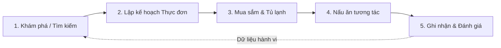
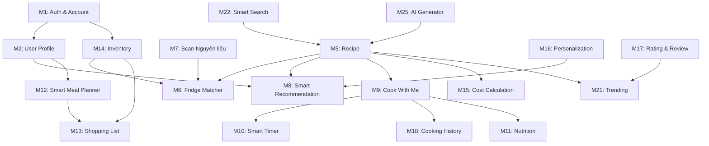

# SmartCook Backend — Requirements Specification

> **Document Type:** Software Requirements Specification (SRS)  
> **Target System:** SmartCook Backend API  
> **Target Clients:** SmartCook Mobile Application (React Native / Expo) & Web Admin  
> **Version:** 1.0  
> **Status:** Active / Living Specification  

---

## 1. Document Purpose
Tài liệu này xác định toàn bộ yêu cầu nghiệp vụ (Business Requirements), yêu cầu chức năng (Functional Requirements), thiết kế dữ liệu mức cao (High-Level Data Requirements) và các ràng buộc phi chức năng (Non-Functional Requirements) cho hệ thống **SmartCook Backend**.

Tài liệu này trả lời câu hỏi cốt lõi: **SMARTCOOK CẦN LÀM GÌ?**  
Mọi thành viên phát triển và hệ thống AI đều phải căn cứ vào tài liệu này để hiểu đúng nghiệp vụ trước khi triển khai bất kỳ tính năng nào.

---

## 2. Project Overview
**SmartCook** là giải pháp trợ lý nấu ăn thông minh toàn diện dành cho thiết bị di động, đồng hành cùng người dùng trong toàn bộ vòng đời nấu nướng gia đình:
- Tìm kiếm và khám phá món ăn phù hợp với thể trạng, mục tiêu sức khỏe và ví tiền.
- Tận dụng tối đa nguyên liệu sẵn có trong tủ lạnh để giảm thiểu lãng phí thực phẩm.
- Hướng dẫn chế biến tương tác theo thời gian thực (Interactive Cook Mode, Voice Guidance, Smart Timer).
- Tự động hóa việc lập kế hoạch bữa ăn (Meal Planner) và đồng bộ danh sách mua sắm thông minh (Shopping List).
- Cá nhân hóa trải nghiệm ăn uống dựa trên hành vi, sở thích và phản hồi thực tế của người dùng.

---

## 3. Problem Statement
Dự án SmartCook được xây dựng nhằm giải quyết 5 vấn đề nhức nhối trong cuộc sống hàng ngày:

1. **Vấn đề 1 — "Hôm nay ăn gì?":** Người dùng mất trung bình 20–30 phút mỗi ngày để đắn đo thực đơn, thường rơi vào cảm giác nhàm chán hoặc ăn uống mất cân bằng.
2. **Vấn đề 2 — Có nguyên liệu nhưng không biết nấu món gì:** Tủ lạnh còn nhiều thực phẩm rải rác (ví dụ: nửa củ cà rốt, 2 quả trứng, 200g thịt gà) nhưng người dùng không biết kết hợp chúng thành món gì khả thi, dẫn đến việc để quên và lãng phí thực phẩm.
3. **Vấn đề 3 — Công thức không cá nhân hóa:** Các công thức nấu ăn trên mạng thường cố định, không tính đến dị ứng cá nhân, mục tiêu calo/macro (eat clean, giảm cân, tăng cơ), số người ăn thực tế hay giới hạn ngân sách.
4. **Vấn đề 4 — Trải nghiệm nấu ăn bất tiện:** Các công thức truyền thống chỉ hiển thị văn bản tĩnh dài dòng. Người dùng vừa nấu vừa phải chạm tay bẩn vào màn hình để cuộn bước hoặc canh chừng giờ.
5. **Vấn đề 5 — Lập kế hoạch thực đơn và đi chợ tốn thời gian:** Việc lên kế hoạch ăn uống 7 ngày và tính toán đúng lượng nguyên liệu cần mua tốn nhiều công sức, dễ dẫn đến mua thừa hoặc mua thiếu.

---

## 4. Project Goals
1. **Goal 1:** Giúp người dùng tìm kiếm và khám phá món ăn theo nhu cầu cá nhân nhanh chóng dưới 1 phút.
2. **Goal 2:** Tận dụng nguyên liệu sẵn có thông qua thuật toán đối soát kho nguyên liệu (Fridge Matcher), giảm ít nhất 30% thực phẩm lãng phí tại hộ gia đình.
3. **Goal 3:** Cung cấp hướng dẫn nấu ăn tương tác trực quan (Cook With Me) kèm timeline và bấm giờ tự động.
4. **Goal 4:** Hỗ trợ quản lý và theo dõi dinh dưỡng (Calories, Macro) so khớp với mục tiêu hàng ngày.
5. **Goal 5:** Tự động hóa lập kế hoạch bữa ăn (Smart Meal Planner) theo ngân sách, số người và calo.
6. **Goal 6:** Tự động tạo danh sách mua sắm (Shopping List) từ thực đơn và tự động trừ đi thực phẩm đã có trong kho.
7. **Goal 7:** Thu thập hành vi để xây dựng mô hình đề xuất cá nhân hóa ngày càng chính xác.
8. **Goal 8:** Ứng dụng AI có trách nhiệm (AI Vision nhận diện nguyên liệu, AI Assistant sinh công thức, Smart Search xử lý ngôn ngữ tự nhiên).

---

## 5. Target Users
1. **Người độc thân & Sinh viên:** Cần nấu ăn nhanh, ngân sách tiết kiệm, khẩu phần 1–2 người, tối giản dụng cụ và thời gian.
2. **Hộ gia đình & Người nội trợ:** Cần lập thực đơn đa dạng cho nhiều người, quản lý chi tiêu chợ búa, đảm bảo vệ sinh và dinh dưỡng cho các thế hệ.
3. **Người quan tâm sức khỏe & Thể hình:** Cần kiểm soát chính xác Calories, Protein, Carbs, Fat, chế độ ăn Eat Clean, Keto, Low Carb, Chay (Vegetarian/Vegan).
4. **Phụ huynh chăm con:** Tìm kiếm các món ăn dặm, món ít gia vị, tạo hứng thú cho trẻ nhỏ và đảm bảo vi chất.

---

## 6. Core User Journey
Một chu trình trải nghiệm cốt lõi của người dùng SmartCook diễn ra qua 5 giai đoạn:



- **Giai đoạn 1 (Khám phá):** Mở app xem gợi ý Home, tìm kiếm thông minh bằng giọng nói/văn bản, hoặc kiểm tra "Tôi có gì trong tủ lạnh?".
- **Giai đoạn 2 (Lập kế hoạch):** Tạo thực đơn 7 ngày theo ngân sách và calo mong muốn.
- **Giai đoạn 3 (Đi chợ & Kho):** Xem Shopping List đã được tự động trừ nguyên liệu trong tủ lạnh; đi chợ và đánh dấu nguyên liệu đã mua.
- **Giai đoạn 4 (Vào bếp):** Bật chế độ "Cook With Me", làm theo từng bước có hẹn giờ tự động và hướng dẫn bằng giọng nói.
- **Giai đoạn 5 (Ghi nhận & Đánh giá):** Hoàn thành món -> Ghi vào nhật ký dinh dưỡng, lưu Cooking History, trừ nguyên liệu trong kho và chấm điểm món ăn.

---

## 7. Product Scope

### 7.1. MVP (Minimum Viable Product)
- **Hạ tầng & Hệ thống:** Base Express + TypeScript, MongoDB connection, Security middleware, Logging, Swagger UI, CI Pipeline.
- **M1:** Authentication & Account (Đăng ký, Đăng nhập JWT, Đổi mật khẩu, Profile cơ bản).
- **M2:** User Profile (Mục tiêu dinh dưỡng, dị ứng, sở thích).
- **M3 & M4:** Home tổng hợp & Phân loại danh mục (Category).
- **M5:** Quản lý kho công thức (Recipe) và bộ lọc cơ bản.
- **M6:** "Tôi có gì trong tủ lạnh?" (Thuật toán Fridge-to-Recipe Matcher theo % nguyên liệu).
- **M14:** Quản lý tủ lạnh gia đình (Inventory cơ bản).
- **M23:** Lưu món yêu thích (Favorite/Save).

### 7.2. Extended Features (Post-MVP)
- **M9 & M10:** Cook With Me tương tác & Smart Timer timeline.
- **M11:** Theo dõi dinh dưỡng chi tiết (Nutrition Tracking & Daily Goal).
- **M12 & M13:** Lập thực đơn tự động (Smart Meal Planner) & Danh sách mua sắm (Shopping List).
- **M15:** Tính toán chi phí món ăn theo ngân sách (Cost Calculation).
- **M16 & M17:** Thu thập hành vi cá nhân hóa & Đánh giá 3 tiêu chí (Rating & Review).
- **M18:** Lịch sử nấu nướng & Thống kê (Cooking History).
- **M20:** Tra cứu thay thế nguyên liệu (Ingredient Substitution).
- **M21:** Bảng xếp hạng thịnh hành (Trending).
- **M24:** Hệ thống thông báo nhắc nhở (Notification).

### 7.3. Future Features (AI & Advanced)
- **M7:** Nhận diện nguyên liệu qua camera / AI Vision (`IngredientRecognitionService`).
- **M8:** Smart Recommendation đa tầng sử dụng Machine Learning.
- **M19:** Tùy biến công thức động (Recipe Remix).
- **M22:** Tìm kiếm ngữ nghĩa thông minh xử lý câu nói tự nhiên (Smart Search Parser).
- **M25:** Sinh công thức mới theo prompt tự do với LLM (AI Recipe Generator).
- Tích hợp Refresh Token, Google OAuth 2.0, Webhook thông báo đẩy FCM (Firebase Cloud Messaging).

---

## 8. Functional Requirements (25 Modules)

> **Quy ước trạng thái implementation:**  
> - `[Implemented]`: Đã hoàn thành trong source code hiện tại.  
> - `[Planned]`: Thuộc phạm vi phát triển chính, đang chuẩn bị code.  
> - `[Future]`: Tính năng mở rộng nâng cao / AI Provider tích hợp sau.

---

### M1. Authentication & Account `[Planned]`

**Purpose**  
Quản trị định danh người dùng, xác thực an toàn bằng JWT và cho phép cập nhật thông tin tài khoản cá nhân.

**Actors**  
- Khách vãng lai (Guest)
- Người dùng đã đăng ký (Registered User)

**Requirements**  
- **FR-AUTH-01:** Cho phép đăng ký bằng Email, Mật khẩu (tối thiểu 6 ký tự), Xác nhận mật khẩu, Họ tên.
- **FR-AUTH-02:** Cho phép đăng nhập bằng Email/Password; trả về JWT Access Token (hạn dùng 7 ngày) kèm thông tin cơ bản của User.
- **FR-AUTH-03:** Cung cấp cơ chế đăng xuất. (MVP: Client tự hủy token phía thiết bị. Future: Server thu hồi refresh token).
- **FR-AUTH-04:** Cho phép yêu cầu khôi phục mật khẩu thông qua Email (sinh mã Token/OTP có hạn 15 phút).
- **FR-AUTH-05:** Cho phép đặt lại mật khẩu mới với Token hợp lệ.
- **FR-AUTH-06:** Cho phép User xem và chỉnh sửa thông tin tài khoản (Họ tên, Avatar URL).
- **FR-AUTH-07:** Cho phép đổi mật khẩu với điều kiện nhập đúng mật khẩu cũ.

**Endpoints**  

| Method | Endpoint | Description | Auth Required | Status |
|---|---|---|:---:|:---:|
| POST | `/api/v1/auth/register` | Đăng ký tài khoản mới | No | Planned |
| POST | `/api/v1/auth/login` | Đăng nhập hệ thống | No | Planned |
| POST | `/api/v1/auth/logout` | Đăng xuất | Yes | Planned |
| POST | `/api/v1/auth/forgot-password` | Gửi mã đặt lại mật khẩu | No | Planned |
| POST | `/api/v1/auth/reset-password` | Đặt lại mật khẩu mới | No | Planned |
| GET | `/api/v1/auth/me` | Lấy thông tin user hiện tại | Yes | Planned |
| PATCH | `/api/v1/auth/update-profile` | Cập nhật avatar, họ tên | Yes | Planned |
| PATCH | `/api/v1/auth/change-password` | Đổi mật khẩu | Yes | Planned |

**Business Rules**  
- Mọi mật khẩu phải được băm bằng `bcrypt` với salt rounds >= 10 trước khi lưu vào DB.
- Email phải được chuẩn hóa về chữ thường (lowercase) và kiểm tra tính duy nhất (unique).
- Khi trả về thông tin User, trường `password` bắt buộc phải bị loại bỏ (`select: false`).

**Dependencies**  
- `User` model, `auth.middleware`, JWT utility.

---

### M2. User Profile & Personalization `[Planned]`

**Purpose**  
Lưu trữ hồ sơ khẩu vị, thói quen ăn uống, dị ứng và chỉ tiêu dinh dưỡng hàng ngày để phục vụ hệ thống gợi ý món ăn.

**Actors**  
- Người dùng đã đăng nhập

**Requirements**  
- **FR-PROF-01:** Cho phép thiết lập mục tiêu ăn uống: `normal`, `weight_loss`, `muscle_gain`, `eat_clean`, `healthy`.
- **FR-PROF-02:** Cho phép chọn danh sách nguyên liệu yêu thích (Favorite Ingredients) và trường phái ẩm thực yêu thích (Món Việt, Món Á, Món Âu...).
- **FR-PROF-03:** Cho phép thiết lập danh sách thực phẩm không thích / không ăn được (Dislikes).
- **FR-PROF-04:** Cho phép chọn chế độ ăn kiêng đặc biệt: `vegetarian`, `vegan`, `low_carb`, `high_protein`, `eat_clean`.
- **FR-PROF-05:** Cho phép khai báo danh sách dị ứng thực phẩm (trứng, sữa, đậu phộng, gluten, hải sản...).
- **FR-PROF-06:** Cho phép tùy chỉnh mục tiêu dinh dưỡng ngày (Daily Nutrition Goal): Calories, Protein, Carbs, Fat.

**Endpoints**  

| Method | Endpoint | Description | Auth Required | Status |
|---|---|---|:---:|:---:|
| GET | `/api/v1/profile` | Xem hồ sơ sở thích & dinh dưỡng | Yes | Planned |
| PUT | `/api/v1/profile` | Cập nhật toàn bộ hồ sơ sở thích | Yes | Planned |
| PATCH | `/api/v1/profile/daily-goal` | Cập nhật riêng chỉ tiêu dinh dưỡng ngày | Yes | Planned |

**Business Rules**  
- Mỗi User chỉ có duy nhất 1 bản ghi `UserProfile` liên kết 1-1 qua `user` ObjectId.
- Nếu người dùng chưa cấu hình `dailyNutritionGoal`, hệ thống sử dụng giá trị mặc định: 2000 kcal, 100g protein, 200g carbs, 60g fat.

**Dependencies**  
- `UserProfile` model, `User` model.

---

### M3. Home `[Planned]`

**Purpose**  
Cung cấp API tổng hợp (BFF / Aggregator Endpoint) cho màn hình chính của ứng dụng Mobile, giảm số lượng round-trip requests.

**Actors**  
- Người dùng (Khách hoặc Đã đăng nhập)

**Requirements**  
- **FR-HOME-01:** Trả về lời chào cá nhân hóa theo thời gian trong ngày (Chào buổi sáng / Buổi trưa / Buổi tối).
- **FR-HOME-02:** Trả về danh sách Quick Actions: "Tôi có gì trong tủ lạnh?", "Scan nguyên liệu", "Gợi ý cho tôi", "Meal Planner".
- **FR-HOME-03:** Trả về danh mục món ăn nổi bật (Active Categories).
- **FR-HOME-04:** Trả về danh sách món được đề xuất riêng (Recommended for you) dựa theo profile người dùng.
- **FR-HOME-05:** Trả về danh sách món đang thịnh hành (Trending Recipes).

**Endpoints**  

| Method | Endpoint | Description | Auth Required | Status |
|---|---|---|:---:|:---:|
| GET | `/api/v1/home` | Lấy toàn bộ dữ liệu tổng hợp cho Home | Optional | Planned |

**Business Rules**  
- Nếu request có token: Cá nhân hóa danh sách đề xuất theo `UserProfile` và `Inventory`.
- Nếu request là khách vãng lai: Trả về danh sách đề xuất mặc định (top rating & trending).

**Dependencies**  
- `CategoryService`, `RecipeService`, `SmartRecommendationService`, `TrendingService`.

---

### M4. Category `[Planned]`

**Purpose**  
Phân loại món ăn theo các nhóm chủ đề ẩm thực nhằm hỗ trợ duyệt và lọc món ăn trực quan.

**Actors**  
- Người dùng, Quản trị viên (Admin)

**Requirements**  
- **FR-CAT-01:** Lấy danh sách toàn bộ các danh mục đang hoạt động (`isActive: true`).
- **FR-CAT-02:** Xem thông tin chi tiết một danh mục theo `slug` kèm danh sách các món ăn thuộc danh mục đó.
- **FR-CAT-03:** Admin có quyền tạo mới, cập nhật hoặc ẩn danh mục.

**Danh mục chuẩn hệ thống:**
1. Gia đình
2. Sức khỏe
3. Trẻ em
4. Cá nhân
5. Nhanh & Tiện lợi
6. Tiết kiệm
7. Tiệc & Dịp đặc biệt
8. Chế độ ăn chay
9. Ẩm thực (Vùng miền/Quốc gia)
10. Đồ uống & Tráng miệng

**Endpoints**  

| Method | Endpoint | Description | Auth Required | Status |
|---|---|---|:---:|:---:|
| GET | `/api/v1/categories` | Lấy danh sách danh mục | No | Planned |
| GET | `/api/v1/categories/:slug` | Chi tiết danh mục & danh sách món | No | Planned |
| POST | `/api/v1/categories` | Tạo danh mục mới (Admin) | Yes (Admin) | Planned |
| PUT | `/api/v1/categories/:id` | Cập nhật danh mục (Admin) | Yes (Admin) | Planned |

**Dependencies**  
- `Category` model, `Recipe` model.

---

### M5. Recipe `[Planned]`

**Purpose**  
Module quản lý dữ liệu công thức nấu ăn cốt lõi của SmartCook.

**Actors**  
- Người dùng, Đầu bếp / Admin

**Requirements**  
- **FR-REC-01:** Xem danh sách công thức có phân trang (`page`, `limit`), hỗ trợ lọc đa tiêu chí: `category`, `difficulty`, `maxTime`, `maxCost`, `diet`, `tags`.
- **FR-REC-02:** Xem chi tiết công thức đầy đủ: Nguyên liệu (tên, định lượng, đơn vị, giá ước tính), các bước thực hiện (ảnh, hướng dẫn, timer, câu lệnh đọc voice), bảng thành phần dinh dưỡng, chi phí ước tính.
- **FR-REC-03:** Tạo mới công thức nấu ăn (hỗ trợ đóng góp từ cộng đồng hoặc Admin).
- **FR-REC-04:** Cập nhật công thức và xóa công thức.
- **FR-REC-05:** Tăng lượt xem (`viewCount`) khi người dùng mở xem chi tiết món ăn.

**Endpoints**  

| Method | Endpoint | Description | Auth Required | Status |
|---|---|---|:---:|:---:|
| GET | `/api/v1/recipes` | Danh sách công thức (có lọc & phân trang) | No | Planned |
| GET | `/api/v1/recipes/:id` | Chi tiết công thức nấu ăn | No | Planned |
| POST | `/api/v1/recipes` | Tạo mới công thức | Yes | Planned |
| PUT | `/api/v1/recipes/:id` | Cập nhật công thức | Yes | Planned |
| DELETE | `/api/v1/recipes/:id` | Xóa công thức | Yes | Planned |

**Business Rules**  
- Mọi nguyên liệu bắt buộc phải có `name`, `quantity`, `unit`.
- Thuộc tính `totalTimeMinutes` tự động tính bằng `prepTimeMinutes + cookTimeMinutes`.
- Khi người dùng xem chi tiết, hệ thống phát sinh event ngầm để ghi nhận vào `UserBehavior` (Module 16).

**Dependencies**  
- `Recipe` model, `Category` model, `User` model.

---

### M6. Fridge-to-Recipe Matcher `[Planned]`

**Purpose**  
Tìm kiếm và xếp hạng các món ăn có thể nấu được dựa trên danh sách nguyên liệu mà người dùng đang có trong tủ lạnh.

**Actors**  
- Người dùng

**Requirements**  
- **FR-FRIDGE-01:** Người dùng gửi lên danh sách các nguyên liệu đang có (hoặc tự động nạp từ Inventory của User).
- **FR-FRIDGE-02:** Hệ thống so khớp với kho công thức và tính toán tỷ lệ phần trăm nguyên liệu đáp ứng:
  $$\text{Matching Score} = \frac{\text{Số nguyên liệu user có khớp với món}}{\text{Tổng số nguyên liệu bắt buộc của món}} \times 100\%$$
- **FR-FRIDGE-03:** Trả về danh sách món sắp xếp giảm dần theo Matching Score (100% -> 80% -> 60%...).
- **FR-FRIDGE-04:** Trả về danh sách chi tiết các nguyên liệu còn thiếu (`missingIngredients`) để người dùng cân nhắc mua thêm.

**Ví dụ nghiệp vụ chuẩn:**
```text
Recipe: "Cơm gà áp chảo" yêu cầu: thịt gà, trứng, cà chua, hành, gạo (5 nguyên liệu bắt buộc)
User có: thịt gà, trứng, cà chua (3 nguyên liệu)
Matching Score = (3 / 5) * 100 = 60%
Missing Ingredients = ["hành", "gạo"] (Thiếu 2 nguyên liệu)
```

**Endpoints**  

| Method | Endpoint | Description | Auth Required | Status |
|---|---|---|:---:|:---:|
| POST | `/api/v1/fridge-matcher` | Match món ăn theo nguyên liệu gửi lên | Optional | Planned |
| GET | `/api/v1/fridge-matcher/my-inventory` | Match món ăn tự động từ kho Inventory cá nhân | Yes | Planned |

**Business Rules**  
- Chỉ so khớp trên các nguyên liệu có thuộc tính `isOptional: false`. Nguyên liệu phụ gia vị (muối, tiêu...) nếu đánh dấu optional sẽ không làm giảm điểm matching.
- Chuẩn hóa tên nguyên liệu (bỏ dấu, lowercase, trim) để tránh sai lệch matching (ví dụ: "Thịt gà" khớp với "thịt gà").

**Dependencies**  
- `Recipe` model, `Inventory` model.

---

### M7. Ingredient Recognition `[Future]`

**Purpose**  
Cung cấp dịch vụ nhận diện thực phẩm qua hình ảnh chụp thực tế (tủ lạnh, bàn bếp) để đưa vào Fridge Matcher.

**Actors**  
- Người dùng

**Requirements**  
- **FR-SCAN-01:** Tiếp nhận hình ảnh thực phẩm tải lên từ camera điện thoại.
- **FR-SCAN-02:** Xử lý nhận diện và trả về danh sách nhãn nguyên liệu được phát hiện kèm độ tin cậy (confidence score).
- **FR-SCAN-03:** Tích hợp trực tiếp kết quả scan với Module 6 để gợi ý ngay: *"Bạn có thể nấu X món từ các nguyên liệu này"*.

**Kiến trúc Abstraction bắt buộc:**
```text
Client Upload Image
        ↓
IngredientRecognitionService
        ↓
VisionProvider (Interface)
        ↓
MockVisionProvider (MVP) / CloudVisionProvider / OpenAIVisionProvider (Future)
```

**Endpoints**  

| Method | Endpoint | Description | Auth Required | Status |
|---|---|---|:---:|:---:|
| POST | `/api/v1/ingredients/scan` | Quét ảnh nhận diện nguyên liệu | Yes | Future |

**Business Rules**  
- MVP triển khai bằng `MockVisionProvider` hoặc quy tắc mẫu có sẵn để client mobile hoàn thiện UI/UX trước khi gắn API Vision thật.
- Tuyệt đối không hard-code thư viện của một nhà cung cấp AI cụ thể vào Service logic.

**Dependencies**  
- `IngredientRecognitionService`, `FridgeMatcherService`.

---

### M8. Smart Recommendation `[Planned]`

**Purpose**  
Hệ thống gợi ý món ăn thông minh đa chiều theo đặc điểm sinh học, sở thích và hoàn cảnh của người dùng.

**Actors**  
- Người dùng

**Requirements**  
- **FR-REC-01:** Loại bỏ triệt để các món có chứa thành phần thuộc danh sách dị ứng (`allergies`) trong `UserProfile`.
- **FR-REC-02:** Ưu tiên các món ăn chứa nguyên liệu người dùng thích (`favoriteIngredients`) hoặc trường phái ẩm thực yêu thích (`favoriteCuisines`).
- **FR-REC-03:** Ưu tiên các món tận dụng được thực phẩm sắp hết hạn trong `Inventory` (Module 14).
- **FR-REC-04:** Điều chỉnh gợi ý theo thời gian thực (Buổi sáng ưu tiên món < 20 phút, buổi trưa ưu tiên món healthy/tiện lợi, buổi tối ưu tiên món ấm cúng).

**Endpoints**  

| Method | Endpoint | Description | Auth Required | Status |
|---|---|---|:---:|:---:|
| GET | `/api/v1/recommendations/daily` | Lấy danh sách 5–10 món đề xuất hôm nay | Yes | Planned |

**Dependencies**  
- `UserProfile`, `Inventory`, `Recipe`, `UserBehavior`.

---

### M9. Cook With Me `[Planned]`

**Purpose**  
Chế độ nấu ăn tương tác từng bước (Step-by-step interactive mode) giúp người dùng nấu ăn dễ dàng, rảnh tay.

**Actors**  
- Người dùng

**Requirements**  
- **FR-COOK-01:** Cung cấp thông tin chi tiết từng bước nấu: số thứ tự bước, nội dung thao tác, nguyên liệu cần dùng riêng cho bước đó, thời gian timer, câu lệnh đọc voice.
- **FR-COOK-02:** Điều khiển trạng thái nấu: `start`, `pause`, `next`, `previous`, `complete`.
- **FR-COOK-03:** Khi người dùng bấm **Hoàn thành (Cook Complete)**:
  - Tự động ghi nhận 1 bản ghi vào `CookingHistory` (Module 18).
  - Tăng `cookCount` của công thức lên 1 đơn vị.
  - Tự động ghi nhận hành vi `cook` vào `UserBehavior` (Module 16).
  - **Tùy chọn trừ kho (Inventory Deduction):** Hỏi xác nhận người dùng; nếu đồng ý, tự động trừ số lượng nguyên liệu tương ứng trong `Inventory` (Module 14).

**Endpoints**  

| Method | Endpoint | Description | Auth Required | Status |
|---|---|---|:---:|:---:|
| GET | `/api/v1/recipes/:id/cook-mode` | Lấy dữ liệu các bước nấu tương tác | Yes | Planned |
| POST | `/api/v1/recipes/:id/cook-complete` | Xác nhận nấu xong món (trừ kho + lưu history) | Yes | Planned |

**Business Rules**  
- Chỉ trừ nguyên liệu trong Inventory khi có cờ `deductInventory: true` được người dùng xác nhận từ Client.

**Dependencies**  
- `Recipe`, `CookingHistory`, `Inventory`, `UserBehavior`.

---

### M10. Smart Timer `[Planned]`

**Purpose**  
Quản lý các mốc thời gian nấu ăn của từng bước và tạo dòng thời gian (Timeline) liên tục cho toàn bộ bữa ăn.

**Actors**  
- Người dùng

**Requirements**  
- **FR-TIMER-01:** Trích xuất toàn bộ thời gian nấu của các bước để dựng một Timeline hoàn chỉnh.
- **FR-TIMER-02:** Hỗ trợ tính toán mốc giờ hoàn thành dự kiến dựa trên thời gian bắt đầu nấu.

**Ví dụ Timeline:**
```text
18:00 — Bước 1: Ướp thịt (⏱ 15 phút)
18:15 — Bước 2: Chiên áp chảo (⏱ 7 phút)
18:22 — Bước 3: Nấu nước sốt (⏱ 5 phút)
18:27 — Hoàn thành món ăn!
```

**Endpoints**  

| Method | Endpoint | Description | Auth Required | Status |
|---|---|---|:---:|:---:|
| GET | `/api/v1/recipes/:id/timeline` | Tính toán timeline nấu nướng của món | No | Planned |

**Dependencies**  
- `Recipe` model.

---

### M11. Nutrition `[Planned]`

**Purpose**  
Theo dõi dinh dưỡng thực tế nạp vào cơ thể và so sánh với chỉ tiêu hàng ngày (Daily Nutrition Goal).

**Actors**  
- Người dùng

**Requirements**  
- **FR-NUT-01:** Hiển thị chi tiết dinh dưỡng cho từng món ăn: Calories, Protein, Carbohydrates, Fat, Fiber, Sugar.
- **FR-NUT-02:** Ghi nhận nhật ký ăn uống (`NutritionLog`) khi người dùng nấu xong hoặc tự log món theo bữa: `breakfast`, `lunch`, `dinner`, `snack`.
- **FR-NUT-03:** Báo cáo tổng lượng Calo và Macro nạp vào trong ngày, so sánh tỷ lệ % hoàn thành mục tiêu ngày trong `UserProfile`.

**Endpoints**  

| Method | Endpoint | Description | Auth Required | Status |
|---|---|---|:---:|:---:|
| GET | `/api/v1/nutrition/summary` | Tổng hợp calo/macro theo ngày (`?date=YYYY-MM-DD`) | Yes | Planned |
| POST | `/api/v1/nutrition/log-meal` | Ghi nhận một bữa ăn vào nhật ký dinh dưỡng | Yes | Planned |

**Dependencies**  
- `UserProfile`, `Recipe`, `NutritionLog` model.

---

### M12. Smart Meal Planner `[Planned]`

**Purpose**  
Tự động lập thực đơn ăn uống trong 7 ngày theo mục tiêu sức khỏe, số người ăn và ngân sách ví tiền.

**Actors**  
- Người dùng

**Requirements**  
- **FR-PLAN-01:** Tạo thực đơn tuần tự động dựa trên tham số đầu vào:
  - Mục tiêu: `weight_loss`, `muscle_gain`, `healthy`, `normal`
  - Số lượng người ăn (`servings`, ví dụ: 2 người)
  - Ngân sách tối đa (`budget`, ví dụ: 500.000 VNĐ)
  - Số ngày: 7 ngày (Thứ 2 -> Chủ nhật), mỗi ngày gồm `breakfast`, `lunch`, `dinner`.
- **FR-PLAN-02:** Xem thực đơn tuần hiện tại của người dùng.
- **FR-PLAN-03:** Cho phép người dùng đổi một món ăn cụ thể trong thực đơn nếu không thích sang món khác cùng nhóm calo/ngân sách.

**Endpoints**  

| Method | Endpoint | Description | Auth Required | Status |
|---|---|---|:---:|:---:|
| POST | `/api/v1/meal-plans/auto-generate` | Tự động sinh thực đơn 7 ngày | Yes | Planned |
| GET | `/api/v1/meal-plans/current` | Lấy thực đơn tuần hiện tại | Yes | Planned |
| PATCH | `/api/v1/meal-plans/meals/:mealId` | Đổi món khác trong thực đơn | Yes | Planned |

**Dependencies**  
- `MealPlan` model, `Recipe` model, `UserProfile` model.

---

### M13. Shopping List `[Planned]`

**Purpose**  
Tự động tổng hợp danh sách nguyên liệu cần mua từ kế hoạch thực đơn và loại trừ những thứ đã có sẵn trong nhà.

**Actors**  
- Người dùng

**Requirements**  
- **FR-SHOP-01:** Tự động quét toàn bộ nguyên liệu cần có trong `MealPlan` của tuần.
- **FR-SHOP-02:** **Quy tắc quan trọng (Inventory Deduction):** Tự động đối chiếu với `Inventory` (Module 14) của người dùng; nguyên liệu nào trong kho đã có đủ số lượng sẽ bị gạch bỏ khỏi danh sách mua sắm; nếu chỉ có một phần thì chỉ mua phần còn thiếu.
- **FR-SHOP-03:** Phân nhóm danh sách mua sắm theo ngành hàng (Thịt, Rau củ quả, Gia vị & Đồ khô, Hải sản...) để tiện đi siêu thị/chợ.
- **FR-SHOP-04:** Cho phép đánh dấu đã mua (`isBought: true/false`).
- **FR-SHOP-05:** Cho phép thêm thủ công nguyên liệu bất kỳ vào danh sách mua sắm.

**Endpoints**  

| Method | Endpoint | Description | Auth Required | Status |
|---|---|---|:---:|:---:|
| GET | `/api/v1/shopping-list` | Lấy danh sách mua sắm hiện tại | Yes | Planned |
| POST | `/api/v1/shopping-list/generate-from-mealplan` | Tự động tạo danh sách mua từ Meal Plan | Yes | Planned |
| PATCH | `/api/v1/shopping-list/items/:itemId` | Đánh dấu đã mua / chưa mua | Yes | Planned |
| POST | `/api/v1/shopping-list/items` | Thêm nguyên liệu thủ công vào danh sách | Yes | Planned |
| DELETE | `/api/v1/shopping-list/items/:itemId` | Xóa nguyên liệu khỏi danh sách mua | Yes | Planned |

**Dependencies**  
- `ShoppingList` model, `MealPlan` model, `Inventory` model.

---

### M14. Inventory ("Tủ lạnh của tôi") `[Planned]`

**Purpose**  
Quản lý kho thực phẩm hiện có tại nhà của người dùng, theo dõi số lượng và cảnh báo hạn sử dụng.

**Actors**  
- Người dùng

**Requirements**  
- **FR-INV-01:** Thêm mới nguyên liệu vào tủ lạnh: tên, số lượng, đơn vị, nhóm thực phẩm, ngày mua, ngày hết hạn.
- **FR-INV-02:** Xem danh sách toàn bộ nguyên liệu đang có trong tủ lạnh.
- **FR-INV-03:** Cập nhật số lượng (khi dùng bớt) hoặc cập nhật ngày hết hạn.
- **FR-INV-04:** Xóa nguyên liệu khỏi tủ lạnh.
- **FR-INV-05:** Lọc và cảnh báo danh sách thực phẩm sắp hết hạn trong vòng 3 ngày tới (`isExpiringSoon`).

**Endpoints**  

| Method | Endpoint | Description | Auth Required | Status |
|---|---|---|:---:|:---:|
| GET | `/api/v1/inventory` | Xem danh sách nguyên liệu trong tủ lạnh | Yes | Planned |
| POST | `/api/v1/inventory` | Thêm nguyên liệu vào tủ lạnh | Yes | Planned |
| PUT | `/api/v1/inventory/:id` | Cập nhật nguyên liệu | Yes | Planned |
| DELETE | `/api/v1/inventory/:id` | Xóa nguyên liệu | Yes | Planned |
| GET | `/api/v1/inventory/expiring` | Lấy danh sách nguyên liệu sắp hết hạn | Yes | Planned |

**Dependencies**  
- `Inventory` model, `User` model.

---

### M15. Cost Calculation `[Planned]`

**Purpose**  
Tính toán chi phí món ăn dựa trên đơn giá nguyên liệu thị trường và cung cấp bộ lọc món ăn theo các nấc ngân sách.

**Actors**  
- Người dùng

**Requirements**  
- **FR-COST-01:** Tự động tính tổng chi phí ước tính của món ăn: $\sum (\text{định lượng} \times \text{đơn giá nguyên liệu})$.
- **FR-COST-02:** Cho phép tìm kiếm và lọc món ăn theo các nấc ngân sách ví tiền:
  - Dưới 20.000 VNĐ
  - 20.000 – 30.000 VNĐ
  - 30.000 – 50.000 VNĐ
  - Trên 50.000 VNĐ

**Endpoints**  

| Method | Endpoint | Description | Auth Required | Status |
|---|---|---|:---:|:---:|
| GET | `/api/v1/recipes/by-budget` | Lọc món theo nấc chi phí (`?tier=<20k|20k-30k|30k-50k|>50k`) | No | Planned |

**Dependencies**  
- `Recipe` model.

---

### M16. Personalization & Behavior Tracking `[Planned]`

**Purpose**  
Ghi nhận các tương tác người dùng trên ứng dụng để cập nhật hồ sơ sở thích bền vững, phục vụ thuật toán Recommendation.

**Actors**  
- Hệ thống, Người dùng

**Requirements**  
- **FR-BEH-01:** Ghi nhận sự kiện hành vi: `view` (xem món), `like` (thích), `save` (lưu), `cook` (nấu), `rate` (đánh giá), `search` (tìm kiếm), `skip` (bỏ qua).
- **FR-BEH-02:** Cơ chế lưu trữ 2 tầng (Two-Tier Persistence):
  - **Raw Behavior Data:** Lưu vào collection `user_behaviors` có cài đặt TTL index (ví dụ: tự hủy sau 90 ngày) để tránh phình to database.
  - **Durable Preference Profile:** Định kỳ tổng hợp hành vi thô thành trọng số sở thích bền vững trong `UserProfile` (ví dụ: thích ăn gà, hay nấu món dưới 30 phút).

**Behavior Flow:**
```text
User Actions (Search, View, Like, Cook, Rate, Skip)
        ↓
UserBehavior Collection (Raw Event with TTL)
        ↓
BehaviorAnalyticsService
        ↓
Durable User Preference (UserProfile)
        ↓
Recommendation Engine
```

**Endpoints**  

| Method | Endpoint | Description | Auth Required | Status |
|---|---|---|:---:|:---:|
| POST | `/api/v1/analytics/track` | Ghi nhận sự kiện hành vi người dùng | Yes | Planned |

**Dependencies**  
- `UserBehavior` model, `UserProfile` model.

---

### M17. Rating & Review `[Planned]`

**Purpose**  
Đánh giá chất lượng món ăn theo 3 tiêu chí trực quan kèm bình luận và hình ảnh thành phẩm của người dùng.

**Actors**  
- Người dùng

**Requirements**  
- **FR-REV-01:** Đánh giá công thức dựa trên 3 tiêu chí riêng biệt (thang điểm 1–5 sao):
  1. Hương vị (Taste)
  2. Độ dễ nấu (Ease)
  3. Chi phí thực tế so với ước tính (Cost Accuracy)
- **FR-REV-02:** Cho phép đính kèm bình luận và hình ảnh thành phẩm tự nấu.
- **FR-REV-03:** Tự động cập nhật điểm trung bình `rating.average` và số lượt đánh giá `rating.count` trong `Recipe` model mỗi khi có review mới.

**Endpoints**  

| Method | Endpoint | Description | Auth Required | Status |
|---|---|---|:---:|:---:|
| POST | `/api/v1/recipes/:id/reviews` | Gửi đánh giá cho món ăn | Yes | Planned |
| GET | `/api/v1/recipes/:id/reviews` | Lấy danh sách đánh giá của món ăn | No | Planned |

**Dependencies**  
- `Review` model, `Recipe` model, `User` model.

---

### M18. Cooking History `[Planned]`

**Purpose**  
Lưu trữ nhật ký các bữa ăn đã hoàn thành và cung cấp báo cáo thống kê thói quen nấu nướng cá nhân.

**Actors**  
- Người dùng

**Requirements**  
- **FR-HIST-01:** Xem danh sách toàn bộ các món đã nấu theo dòng thời gian (ngày nấu, số khẩu phần, thời gian nấu).
- **FR-HIST-02:** Xem báo cáo thống kê: Tổng số bữa ăn đã tự nấu, tỷ lệ nhóm món (Healthy, High Protein, Món Á...).

**Endpoints**  

| Method | Endpoint | Description | Auth Required | Status |
|---|---|---|:---:|:---:|
| GET | `/api/v1/cooking-history` | Xem lịch sử các món đã nấu | Yes | Planned |
| GET | `/api/v1/cooking-history/stats` | Thống kê số lượng bữa nấu và nhóm món | Yes | Planned |

**Dependencies**  
- `CookingHistory` model, `Recipe` model.

---

### M19. Recipe Remix `[Future]`

**Purpose**  
Cho phép biến đổi công thức nấu ăn linh hoạt theo nguyên liệu đang có hoặc khẩu vị đặc biệt của người dùng.

**Actors**  
- Người dùng

**Requirements**  
- **FR-RMX-01:** Người dùng yêu cầu thay thế nguyên liệu trong công thức (ví dụ: món Carbonara thay thịt xông khói bằng thịt gà).
- **FR-RMX-02:** Tùy biến cấp độ: Chuyển món mặn thành món chay (Vegetarian version), giảm cay (Mild/No spicy).
- **FR-RMX-03:** Tính toán lại định lượng, thời gian nấu và bảng dinh dưỡng tương ứng cho công thức remix.

**Endpoints**  

| Method | Endpoint | Description | Auth Required | Status |
|---|---|---|:---:|:---:|
| POST | `/api/v1/recipes/:id/remix` | Gửi yêu cầu tùy biến công thức | Yes | Future |

**Dependencies**  
- `Recipe` model, `IngredientSubstitution` model.

---

### M20. Ingredient Substitution `[Planned]`

**Purpose**  
Tra cứu từ điển và tỷ lệ quy đổi khi thiếu một nguyên liệu trong lúc nấu ăn.

**Actors**  
- Người dùng

**Requirements**  
- **FR-SUB-01:** Tra cứu nguyên liệu thay thế cho một thành phần cụ thể.
- **FR-SUB-02:** Cung cấp tỷ lệ quy đổi và ghi chú chế biến (Ví dụ: Cần 1 cup bơ lạt -> có thể thay bằng 3/4 cup dầu olive; Cần whipping cream -> thay bằng sữa tươi + bơ).

**Endpoints**  

| Method | Endpoint | Description | Auth Required | Status |
|---|---|---|:---:|:---:|
| GET | `/api/v1/substitutions/:ingredient` | Tra cứu nguyên liệu thay thế | No | Planned |

**Dependencies**  
- `IngredientSubstitution` model.

---

### M21. Trending `[Planned]`

**Purpose**  
Xây dựng bảng xếp hạng các món ăn đang phổ biến và được quan tâm nhiều nhất trong cộng đồng SmartCook.

**Actors**  
- Người dùng

**Requirements**  
- **FR-TRD-01:** Tính toán điểm thịnh hành (Trending Score) dựa trên công thức cơ sở:
  $$\text{Trending Score} = (\text{views} \times 1) + (\text{likes} \times 2) + (\text{saves} \times 3) + (\text{cooks} \times 5) + (\text{avgRating} \times 4)$$
- **FR-TRD-02:** Trả về danh sách Top 10–20 món trending có thể lọc theo tuần hoặc tháng.

**Endpoints**  

| Method | Endpoint | Description | Auth Required | Status |
|---|---|---|:---:|:---:|
| GET | `/api/v1/recipes/trending` | Lấy danh sách món đang thịnh hành | No | Planned |

**Business Rules**  
- Trọng số tính điểm (weights) phải được khai báo dạng cấu hình (config/constant) trong Service để có thể tinh chỉnh sau này mà không sửa đổi code core.

**Dependencies**  
- `Recipe` model.

---

### M22. Smart Search `[Future]`

**Purpose**  
Tìm kiếm ngữ nghĩa thông minh: Chuyển câu yêu cầu ngôn ngữ tự nhiên thành tiêu chí tìm kiếm MongoDB an toàn.

**Actors**  
- Người dùng

**Requirements**  
- **FR-SRCH-01:** Tiếp nhận câu tìm kiếm tự nhiên của người dùng, ví dụ:
  - *"Món dưới 30 phút có thịt gà"*
  - *"Món healthy dưới 500 calories"*
  - *"Món cho 2 người dưới 100k"*
  - *"Món không cay có thịt bò"*
- **FR-SRCH-02:** Bộ phân tích (SmartSearchParser) phân tách câu nói thành cấu trúc tiêu chí (Criteria):
  ```json
  {
    "ingredients": ["thịt gà"],
    "maxTime": 30,
    "maxCalories": null,
    "maxCost": null,
    "diet": null,
    "excludeIngredients": []
  }
  ```
- **FR-SRCH-03:** Backend chuyển cấu trúc criteria an toàn thành MongoDB query.

**Nguyên tắc kiến trúc an ninh bắt buộc:**
```text
Natural Language Query
        ↓
SmartSearchParser (Rule-based Regex / LLM Parser)
        ↓
Structured SearchCriteria Object
        ↓
RecipeService (Validate & Build Safe Mongo Query)
        ↓
MongoDB Query Execution
```
*Tuyệt đối không bao giờ cho LLM sinh thẳng câu lệnh MongoDB Query thô.*

**Endpoints**  

| Method | Endpoint | Description | Auth Required | Status |
|---|---|---|:---:|:---:|
| GET | `/api/v1/search/smart` | Tìm kiếm bằng câu tự nhiên (`?q=...`) | No | Future |

**Dependencies**  
- `Recipe` model, `SmartSearchParser`.

---

### M23. Favorite / Save `[Planned]`

**Purpose**  
Lưu trữ các món ăn yêu thích và quản lý theo từng bộ sưu tập cá nhân (Bữa sáng, Healthy, Cuối tuần...).

**Actors**  
- Người dùng

**Requirements**  
- **FR-FAV-01:** Thả tim / Lưu món ăn vào danh sách yêu thích (Toggle favorite).
- **FR-FAV-02:** Xem danh sách toàn bộ các món đã lưu của người dùng.
- **FR-FAV-03:** Tạo và quản lý các bộ sưu tập yêu thích tùy chọn (`FavoriteCollection`).

**Endpoints**  

| Method | Endpoint | Description | Auth Required | Status |
|---|---|---|:---:|:---:|
| POST | `/api/v1/favorites/toggle/:recipeId` | Thích / Bỏ thích món ăn | Yes | Planned |
| GET | `/api/v1/favorites` | Lấy danh sách món đã lưu | Yes | Planned |
| POST | `/api/v1/favorites/collections` | Tạo bộ sưu tập mới | Yes | Planned |

**Dependencies**  
- `Favorite` model, `Recipe` model, `User` model.

---

### M24. Notification `[Planned]`

**Purpose**  
Hệ thống thông báo đẩy và nhắc nhở đúng thời điểm cho người dùng.

**Actors**  
- Người dùng, Hệ thống (Cron Jobs)

**Requirements**  
- **FR-NOTI-01:** Thông báo hẹn giờ nấu ăn hoàn thành (Cooking Timer).
- **FR-NOTI-02:** Thông báo nhắc nhở chuẩn bị bữa ăn theo thực đơn (Meal Reminder).
- **FR-NOTI-03:** Cảnh báo nguyên liệu trong tủ lạnh sắp hết hạn (Expiring Inventory).
- **FR-NOTI-04:** Xem danh sách thông báo và đánh dấu đã đọc.

**Endpoints**  

| Method | Endpoint | Description | Auth Required | Status |
|---|---|---|:---:|:---:|
| GET | `/api/v1/notifications` | Lấy danh sách thông báo của user | Yes | Planned |
| PATCH | `/api/v1/notifications/:id/read` | Đánh dấu đã đọc một thông báo | Yes | Planned |
| PATCH | `/api/v1/notifications/read-all` | Đánh dấu đã đọc tất cả | Yes | Planned |

**Dependencies**  
- `Notification` model.

---

### M25. AI Recipe Generator `[Future]`

**Purpose**  
Ứng dụng trí tuệ nhân tạo (LLM) để sáng tạo công thức nấu ăn mới hoàn chỉnh theo yêu cầu và nguyên liệu bất kỳ.

**Actors**  
- Người dùng

**Requirements**  
- **FR-AI-01:** Nhận đầu vào từ người dùng: Danh sách nguyên liệu có sẵn, thời gian tối đa, ngân sách, mục tiêu dinh dưỡng, số người ăn.
- **FR-AI-02:** Yêu cầu LLM sinh công thức mới dưới dạng cấu trúc dữ liệu JSON chuẩn mực khớp với `Recipe` Schema (tên món, nguyên liệu, định lượng, các bước nấu, dinh dưỡng ước tính, chi phí).
- **FR-AI-03:** Cho phép người dùng lưu công thức AI vừa tạo vào kho công thức cá nhân.

**Kiến trúc Abstraction bắt buộc:**
```text
AIRecipeGeneratorService
        ↓
LLMProvider (Interface)
        ↓
OpenAIProvider / GeminiProvider / LocalLLMProvider
```

**Endpoints**  

| Method | Endpoint | Description | Auth Required | Status |
|---|---|---|:---:|:---:|
| POST | `/api/v1/ai/generate-recipe` | Yêu cầu AI sinh công thức nấu ăn mới | Yes | Future |

**Business Rules**  
- Đầu ra của AI phải được validate bằng schema Joi nghiêm ngặt trước khi trả về client để đảm bảo cấu trúc JSON không bị lỗi hoặc thiếu trường.

**Dependencies**  
- `AIRecipeGeneratorService`, `Recipe` model.

---

## 9. Business Rules (Tổng hợp quy tắc nghiệp vụ)

1. **Bảo mật dữ liệu định danh:** Không bao giờ lưu trữ mật khẩu dạng plain-text; luôn sử dụng hash `bcrypt`. Token truy cập luôn đi kèm hạn sử dụng.
2. **Nguyên tắc an toàn thực phẩm (Allergy-Safety First):** Thuật toán gợi ý hoặc đề xuất thực đơn bắt buộc phải loại trừ tất cả các món ăn chứa thành phần nằm trong danh mục dị ứng (`allergies`) của người dùng.
3. **Quy tắc bảo toàn kho thực phẩm (Non-destructive Cooking):** Khi hoàn tất nấu ăn, chỉ trừ thực phẩm trong tủ lạnh (`Inventory`) nếu người dùng xác nhận cho phép.
4. **Quy tắc đối trừ thông minh khi đi chợ:** Danh sách mua sắm sinh từ thực đơn tuần bắt buộc phải trừ đi số lượng thực phẩm còn hạn sử dụng đang có sẵn trong kho.
5. **Giới hạn tốc độ gọi API (Rate Limiting):**
   - API thông thường: Tối đa 100 requests / 15 phút trên mỗi IP.
   - API xác thực (Login/Register/Forgot-password): Tối đa 10 requests / 15 phút để ngăn chặn dò mật khẩu (Brute-force).

---

## 10. Feature Dependencies

Sơ đồ phụ thuộc giữa các modules nghiệp vụ:



---

## 11. AI Features Specification

SmartCook tích hợp 4 năng lực AI chuyên biệt theo kiến trúc lỏng (loosely coupled):

| Tính năng | Module | Công nghệ AI | Kiến trúc xử lý |
|---|:---:|---|---|
| **Scan Nguyên liệu** | M7 | Computer Vision (CNN / Vision Transformer) | `IngredientRecognitionService` -> `VisionProvider` |
| **Gợi ý Cá nhân hóa** | M8 | Rule-based Filtering & Collaborative Filtering | `SmartRecommendationService` phân tích điểm số sở thích |
| **Tìm kiếm Ngữ nghĩa** | M22 | Natural Language Processing (Intent/Slot extraction) | `SmartSearchParser` trích xuất `SearchCriteria` an toàn |
| **Sáng tạo Công thức** | M25 | Large Language Model (Gemini / OpenAI) | `AIRecipeGeneratorService` -> `LLMProvider` sinh Structured JSON |

---

## 12. High-Level Data Requirements

Hệ thống định nghĩa các thực thể dữ liệu (Entities) tương ứng với các Mongoose Collections:

1. **`User`**: Tài khoản người dùng (email, password, fullName, avatar, role, isEmailVerified).
2. **`UserProfile`**: Hồ sơ khẩu vị & thể trạng (goal, favoriteIngredients, favoriteCuisines, dislikes, diets, allergies, dailyNutritionGoal).
3. **`Category`**: Phân loại món ăn (name, slug, icon, description, subcategories, order, isActive).
4. **`Recipe`**: Công thức nấu ăn cốt lõi (title, slug, image, description, prepTime, cookTime, servings, estimatedCost, ingredients[], steps[], nutrition, tags[], rating, viewCount, cookCount, saveCount).
5. **`Inventory`**: Tủ lạnh người dùng (user, name, quantity, unit, category, purchaseDate, expirationDate, isExpiringSoon).
6. **`MealPlan`**: Thực đơn tuần (user, startDate, endDate, targetCalories, servings, budget, days[]).
7. **`ShoppingList`**: Danh sách mua sắm (user, mealPlan, title, items[ingredientName, quantity, unit, isBought]).
8. **`Review`**: Đánh giá 3 tiêu chuẩn (user, recipe, ratings{taste, ease, costAccuracy}, comment, photos[]).
9. **`CookingHistory`**: Lịch sử nấu (user, recipe, cookedAt, servings, durationMinutes, notes).
10. **`UserBehavior`**: Dữ liệu hành vi thô (user, action, recipe, metadata, createdAt với TTL index).
11. **`IngredientSubstitution`**: Từ điển thay thế (originalIngredient, substituteIngredient, ratio, notes).
12. **`Notification`**: Thông báo người dùng (user, type, title, body, data, isRead).
13. **`Favorite`**: Món yêu thích & bộ sưu tập (user, recipe, collectionName, createdAt).
14. **`NutritionLog`**: Nhật ký ăn uống theo ngày (user, recipe, mealType, date, calories, protein, carbs, fat).

---

## 13. Non-Functional Requirements

1. **Bảo mật (Security):**
   - Áp dụng chuẩn OWASP cơ bản: Chống XSS, Clickjacking, MIME sniffing qua `helmet`.
   - Chặn DoS và brute-force qua `express-rate-limit`.
   - Toàn bộ dữ liệu truyền nhận qua mạng phải hỗ trợ HTTPS/TLS trên môi trường Production.
2. **Hiệu năng & Tối ưu (Performance):**
   - Thời gian phản hồi API (Latency) trung bình < 200ms cho các truy vấn dữ liệu chuẩn.
   - Nén phản hồi HTTP bằng Gzip (`compression`).
   - Đánh index phù hợp cho các trường thường xuyên query (`slug`, `user`, `category`, text search trên `title`/`tags`).
3. **Độ tin cậy & Ổn định (Reliability):**
   - Hỗ trợ Graceful Shutdown khi nhận tín hiệu dừng hệ điều hành (`SIGTERM`, `SIGINT`), đảm bảo không ngắt kết nối đột ngột gây hỏng dữ liệu MongoDB.
   - Hệ thống tự động phục hồi kết nối database khi có sự cố mạng.
4. **Khả năng mở rộng (Scalability):**
   - Thiết kế Stateless API (không lưu session trong bộ nhớ server) để sẵn sàng mở rộng ngang (Horizontal Scaling) với Docker và Load Balancer.

---

## 14. API Requirements

- **Base URL Prefix:** Mọi API nghiệp vụ đều có tiền tố: `/api/v1`
- **Tài liệu API (Swagger UI):** Khai báo tại `/api-docs`
- **Định dạng Response Envelope:**
  - **Thành công (Success):**
    ```json
    {
      "success": true,
      "message": "Thông báo thành công",
      "data": {}
    }
    ```
  - **Danh sách có phân trang (Pagination):**
    ```json
    {
      "success": true,
      "message": "Lấy danh sách thành công",
      "data": [],
      "pagination": {
        "page": 1,
        "limit": 10,
        "total": 100,
        "totalPages": 10
      }
    }
    ```
  - **Thất bại (Error):**
    ```json
    {
      "success": false,
      "message": "Mô tả nguyên nhân lỗi"
    }
    ```
- **Quy chuẩn mã lỗi HTTP (Status Codes):**
  - `200 OK`: Truy vấn / cập nhật thành công.
  - `201 Created`: Tạo mới tài nguyên thành công.
  - `400 Bad Request`: Sai định dạng dữ liệu đầu vào hoặc vi phạm validation Joi.
  - `401 Unauthorized`: Chưa đăng nhập hoặc Token không hợp lệ / hết hạn.
  - `403 Forbidden`: Không có quyền truy cập tài nguyên (ví dụ: User thường cố gọi API Admin).
  - `404 Not Found`: Không tìm thấy endpoint hoặc tài nguyên trong database.
  - `500 Internal Server Error`: Lỗi xử lý ngoại lệ phía máy chủ.

---

## 15. Future Extensions
1. **Kết nối Siêu thị / Sàn thương mại điện tử:** Tự động chuyển `ShoppingList` thành giỏ hàng trên các ứng dụng giao hàng (GrabMart, ShopeeFood, WinMart...).
2. **Cộng đồng chia sẻ công thức (Community & Social):** Cho phép người dùng đăng tải công thức của chính mình, follow đầu bếp, bình luận tương tác.
3. **Tích hợp thiết bị bếp thông minh (Smart IoT Kitchen):** Tự động gửi thông số nhiệt độ, thời gian của bước nấu đến nồi chiên không dầu, lò nướng thông minh.
